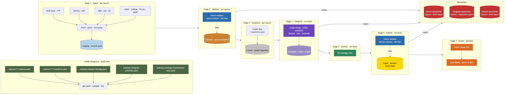

# silicoKG

silicoKG builds a **biomedical knowledge graph** of human gene and protein biology for intelligent platforms and machine learning. The graph is meant to be consumed by search, reasoning, and analytics systems that need typed entities, stable identifiers, and trustworthy relationships—not ad hoc tables stitched together at query time.

The design centers control at the **semantic layer**. Source schemas, transform specs, merge rules, classification logic, and the published domain model are all declared in LinkML and validated at every gate. Ingest normalizes publisher snapshots into typed rows; transform maps those rows into graph fragments; integrate reconciles fragments into canonical nodes and edges; publish projects the result into a consumer-facing schema. Each step is schema-checked, so drift is caught early rather than propagated into downstream applications.

**Provenance is preserved end to end.** Every silver fragment carries source metadata (which dataset, which run, which upstream row). Merge and publish retain that lineage, so you can trace any node or edge back to the originating record and publisher snapshot. Quarantine tiers capture rejects and drift reports without silently dropping or rewriting data.

This guide walks through setup, the end-to-end pipeline, and each stage in order.

---

## Getting started

### 1. Install

```bash
python -m venv .venv
source .venv/bin/activate
pip install -r requirements.txt
# linkml-map, pandas, and other pipeline deps are expected in the venv
```

All commands below assume you are at the repo root with the venv active. Prefix commands with `PYTHONPATH=.` so local packages resolve correctly.

### 2. Prepare local data

Some sources download automatically at ingest time; others need files under `data/` (gitignored). Download these before running the corresponding sources:

| Source | Local path |
|--------|------------|
| `ncbi-gene-refseq-to-uniprot` | `data/ncbi/gene_refseq_uniprotkb_collab` |
| `uniprot-gaf` | `data/uniprot/HUMAN-uniprot.gaf` |
| `obo-go` | `data/go-plus.owl` |
| `corum-human-complexes` | `data/corum/corum_humanComplexes.json` |

HTTP-backed sources (NCBI Gene, HGNC, TFLink, MeSH, Sequence Ontology, etc.) are configured in [`pipeline/ingest/config.yaml`](pipeline/ingest/config.yaml).

### 3. Run your first pipeline

The easiest path is a YAML run config under `pipeline/run/examples/`:

```bash
PYTHONPATH=. python -m pipeline.run.cli pipeline/run/examples/test-corum.yaml
```

That example ingests CORUM complexes (plus supporting GO and UniProt sources), runs every stage through Neo4j export, and writes artifacts under `universe/test-corum/`.

### 4. Run tests

```bash
PYTHONPATH=. python -m pytest pipeline/ sources/ -q
```

---

## Pipeline overview



Each **run** is identified by a `run_id`. All artifacts for that run live under `universe/{run_id}/` in numbered tiers. Stages 1–3 run **once per source**; stages 4–7 run **once per run**, reading silver output from every selected source.

| Stage | Scope | Tier | Primary output |
|-------|-------|------|----------------|
| Ingest | per source | `1-staging/{source}/` | Normalized rows (`records.jsonl`) |
| Validate | per source | `2-bronze/{source}/` | Source-schema-validated rows |
| Transform | per source | `3-silver/{source}/` | LinkML graph fragments (`fragments.jsonl`) |
| Integrate | run-level | `4-merged/` | Merged `nodes.jsonl`, `edges.jsonl` |
| Classify | run-level | `4-merged/` | SO-based node typing applied in place |
| Publish | run-level | `5-gold/` | Domain-schema-conformant graph |
| Export Neo4j | run-level (optional) | `5-gold/export/neo4j/` | Bulk-import CSV + manifest |
| Load Neo4j | run-level (optional) | — | Populated Neo4j database |

Invalid rows are quarantined at validate (source schema), integrate (merge resolution), and publish (domain schema). Each quarantine tier writes rejects plus a drift or resolution report.

**LinkML blueprints** (build time): per-source schemas and transform specs under `sources/`, domain model in `schemas/domain/silicokg.yaml`, merge priorities in `schemas/integrate-priorities.yaml`, and classification rules in `schemas/ontology/classification-rules.yaml`.

HTTP fetch cache (shared across runs): `universe/cache/{source_name}/`.

---

## Orchestrating a run

Declare `run_id`, sources, and stages in a YAML file. Example:

```yaml
run_id: test-x
sources:
  - source: ncbi
    source_name: ncbi-gene-info
  - source: uniprot
    source_name: uniprot-gaf

stages:
  - ingest
  - validate
  - transform
  - integrate
  - classify
  - publish
  - export_neo4j

classify:
  source: obo
  source_name: obo-so
  rules: schemas/ontology/classification-rules.yaml

publish:
  schema: schemas/domain/silicokg.yaml
  exclude_edge_types: [GeneHasDbXref]

export_neo4j:
  stub_nodes: false
```

Run it:

```bash
PYTHONPATH=. python -m pipeline.run.cli pipeline/run/examples/ncbi-gene-info-summary.yaml
```

See [`pipeline/run/README.md`](pipeline/run/README.md) for all YAML fields. Per-source stages execute for every listed source; integrate, classify, publish, and export run once after transforms complete.

To re-run only downstream stages (e.g. after adding a source), list just those stages and ensure upstream tiers already exist for the same `run_id`. Example: [`pipeline/run/examples/test-x-hgnc-refresh.yaml`](pipeline/run/examples/test-x-hgnc-refresh.yaml) runs integrate → classify → publish → export without re-ingesting.

---

## Pipeline stages

The sections below follow the order data flows through the system.

### Ingest

**Scope:** per source  
**Input:** remote URL, FTP, or local file (see ingest config)  
**Output:** `universe/{run_id}/1-staging/{source}/records.jsonl`

Fetch or read a publisher snapshot and parse it into normalized JSONL rows. Remote files are cached under `universe/cache/{source_name}/` until `ttl_seconds` expires.

```bash
PYTHONPATH=. python -m pipeline.ingest.cli \
  --source ncbi \
  --source-name ncbi-gene-info \
  --run-id test-x \
  --snapshot-raw \
  -v
```

- Config: [`pipeline/ingest/config.yaml`](pipeline/ingest/config.yaml)
- Source schema: `sources/{provider}/{module}/{source-name}.schema.yaml`
- Also writes `manifest.json`; optional `raw/` snapshot and `rejects.jsonl`

More detail: [`pipeline/ingest/README.md`](pipeline/ingest/README.md)

### Validate

**Scope:** per source  
**Input:** `1-staging/{source}/records.jsonl`  
**Output:** `universe/{run_id}/2-bronze/{source}/records.jsonl`

Validate staging rows against the source LinkML schema. Invalid rows go to `quarantine.jsonl`; a `drift_report.json` captures schema drift.

```bash
PYTHONPATH=. python -m pipeline.validate.cli \
  --source ncbi \
  --source-name ncbi-gene-info \
  --run-id test-x \
  --staging-run-id test-x
```

### Transform

**Scope:** per source  
**Input:** `2-bronze/{source}/records.jsonl`  
**Output:** `universe/{run_id}/3-silver/{source}/fragments.jsonl`

Map bronze rows to domain graph fragments using LinkML-Map derivations defined in each source's transform YAML.

```bash
PYTHONPATH=. python -m pipeline.transform.cli \
  --source ncbi \
  --source-name ncbi-gene-info \
  --source-row-class NCBIGeneInfoRow \
  --bronze-run-id test-x \
  --run-id test-x
```

Each silver line is a **fragment envelope** — a typed node or edge candidate plus source provenance:

```json
{
  "class": "Gene",
  "object": { "id": "silkg:Gene:9606:1", "@type": "Gene" },
  "source": {
    "source_name": "ncbi-gene-info",
    "silver_run_id": "test-x",
    "bronze_line": 0
  }
}
```

Use `--workers N` for parallel bronze sharding and `--limit N` for dev runs. Orchestrator YAML accepts a `transform:` block with `parallel_sources`, `workers`, and `limit`.

More detail: [`pipeline/transform/README.md`](pipeline/transform/README.md)

### Integrate

**Scope:** run-level (all sources)  
**Input:** every `3-silver/{source}/fragments.jsonl` for the run  
**Output:** `universe/{run_id}/4-merged/nodes.jsonl`, `edges.jsonl`

Merge silver fragments into canonical nodes and edges. Source priority and slot-level overrides come from [`schemas/integrate-priorities.yaml`](schemas/integrate-priorities.yaml). URI formulas and merge rules are documented in [`docs/plans/identity-contract.md`](docs/plans/identity-contract.md).

```bash
PYTHONPATH=. python -m pipeline.integrate.cli \
  --run-id test-x \
  --sources ncbi-gene-info ncbi-gene-summary uniprot-gaf
```

Also writes `resolution_report.json`, `quarantine.jsonl`, and `manifest.json`.

More detail: [`pipeline/integrate/README.md`](pipeline/integrate/README.md)

### Classify

**Scope:** run-level  
**Input:** `4-merged/nodes.jsonl` + Sequence Ontology index  
**Output:** updated `4-merged/nodes.jsonl` (with SO-based typing applied)

Apply ontology-driven classification rules to merged nodes — for example, refining transcript or sequence types using the SO OWL index built from `obo-so`.

```bash
PYTHONPATH=. python -m pipeline.ontology.classify.cli \
  --run-id test-x \
  --source-name obo-so \
  --rules schemas/ontology/classification-rules.yaml
```

Configure via the `classify:` block in run YAML. Unmapped values are skipped and counted in `classify-manifest.json`.

### Publish

**Scope:** run-level  
**Input:** `4-merged/`  
**Output:** `universe/{run_id}/5-gold/nodes.jsonl`, `edges.jsonl`

Project the merged graph into the consumer-facing domain schema ([`schemas/domain/silicokg.yaml`](schemas/domain/silicokg.yaml)). Invalid nodes or edges are quarantined under `5-gold/quarantine/`.

```bash
PYTHONPATH=. python -m pipeline.publish.cli \
  --run-id test-x \
  --schema schemas/domain/silicokg.yaml
```

Use `exclude_edge_types` in run YAML to drop internal xref edges from the published graph.

### Export Neo4j

**Scope:** run-level  
**Input:** `5-gold/`  
**Output:** `universe/{run_id}/5-gold/export/neo4j/nodes/{Label}.csv`, `relationships.csv`, `manifest.json`

Convert gold JSONL into Neo4j bulk-import CSV. Set `stub_nodes: true` in partial runs when endpoint nodes may be missing.

```bash
PYTHONPATH=. python -m pipeline.export.neo4j.cli \
  --run-id test-x \
  --run-config pipeline/run/examples/ncbi-gene-info-summary.yaml
```

Or include `export_neo4j` in the run YAML `stages` list.

### Load Neo4j

**Scope:** run-level (optional, outside main YAML stages)  
**Input:** Neo4j export manifest or CSV paths  
**Output:** populated Neo4j database

**Bulk import (recommended for large graphs)** — Neo4j must be stopped:

```bash
PYTHONPATH=. python -m pipeline.load.neo4j.cli \
  --admin \
  --run-id test-x \
  --overwrite
```

Preview without executing: add `--dry-run`. Set `NEO4J_HOME` if `neo4j-admin` is not on `PATH`.

**Live Bolt load** (slower; requires `pip install neo4j`):

```bash
export NEO4J_URI=bolt://localhost:7687
export NEO4J_PASSWORD=your-password

PYTHONPATH=. python -m pipeline.load.neo4j.cli \
  --manifest universe/test-x/5-gold/export/neo4j/manifest.json
```

More Neo4j detail: [`pipeline/README.md`](pipeline/README.md)

---

## Sources

Each source is a package under `sources/{provider}/{module}/` with an adapter, optional parser, source schema, and transform spec. Adapters are registered in [`sources/registry.py`](sources/registry.py).

| Provider | Sources |
|----------|---------|
| NCBI Gene | `ncbi-gene-info`, `ncbi-gene-summary`, `ncbi-gene-group`, `ncbi-gene2refseq`, `ncbi-gene-refseq-to-uniprot` |
| UniProt | `uniprot-gaf` |
| OBO | `obo-go`, `obo-so` |
| HGNC | `hgnc-gene-groups` |
| CORUM | `corum-human-complexes` |
| TFLink | `tflink-tf-interactions` |
| NIH MeSH | `nih-mesh`, `bioconductor-meshdbi` |

Example run configs: [`pipeline/run/examples/`](pipeline/run/examples/)

---

## Repository layout

| Path | Purpose |
|------|---------|
| `pipeline/` | Stage CLIs, orchestration, I/O, Neo4j export/load |
| `sources/` | Per-source adapters and LinkML transform specs |
| `schemas/` | Domain model, slots, prefixes, merge priorities, classification rules |
| `assets/` | Pipeline diagram (`gckg.mmd`, `gckg.png`) |
| `fixtures/` | Small test inputs (tracked in git) |
| `data/` | Local raw datasets (not in git) |
| `universe/` | Pipeline run output (not in git) |
| `docs/plans/` | Design and ingestion plans |

Key schema registries:

| File | Role |
|------|------|
| `schemas/prefixes.yaml` | CURIE prefix map |
| `schemas/enums/edge-predicates.yaml` | Edge class → predicate CURIE |
| `schemas/integrate-priorities.yaml` | Source rank and slot overrides for merge |
| `schemas/ontology/classification-rules.yaml` | SO-driven node classification rules |
| `schemas/domain/silicokg.yaml` | Published domain schema |

---

## Further reading

| Document | Topic |
|----------|-------|
| [`pipeline/README.md`](pipeline/README.md) | Tier paths, silver envelope, Neo4j details |
| [`docs/plans/identity-contract.md`](docs/plans/identity-contract.md) | URI formulas and merge semantics |
| [`docs/plans/corum-ingestion.md`](docs/plans/corum-ingestion.md) | CORUM source design |
| [`docs/plans/genomic-location-model.md`](docs/plans/genomic-location-model.md) | Genomic location modeling |
| [`docs/plans/transform-integrate-performance.md`](docs/plans/transform-integrate-performance.md) | Transform/integrate performance |

Benchmark transform and integrate timings from run manifests:

```bash
scripts/bench_transform_integrate.sh test-x
```
