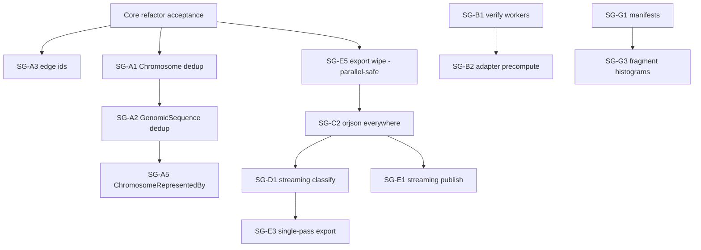

# Genomic location model — proposal

Refactor how silicoKG represents **chromosomes**, **RefSeq genomic contigs**, and **gene placement** so location semantics are explicit, NC chromosome molecules are not modeled as genes, and `SAME_AS` is reserved for identity equivalence.

**Status:** Draft proposal — agent-executable  
**Audience:** Human reviewers + AI coding agents  
**Context:** [`identity-contract.md`](./identity-contract.md), [`transform-integrate-performance.md`](./transform-integrate-performance.md)  
**Primary code paths:** `schemas/domain/`, `sources/ncbi/`, `pipeline/{transform,integrate,ontology/classify,publish,export/neo4j}/`  
**Benchmark run id:** `test-x` (full); `test-small` (CI gate)  
**Observed in:** `test-x` gold (Aug 2026)

### Agent execution rules

1. **Do not start stretch goals (SG-*) until core acceptance criteria (§ Acceptance criteria) pass**, unless the task is explicitly marked *parallel-safe*.
2. **One SG-ID per PR** when possible; always run verification commands listed under that task.
3. **Environment:** repo root, `PYTHONPATH=.`, venv at `.venv/bin/python`.
4. **Never commit** unless the user asks; leave manifests under `universe/` as local benchmark artifacts.
5. **Regression gate:** `PYTHONPATH=. .venv/bin/python -m pytest pipeline/transform/tests pipeline/integrate/tests pipeline/ontology/tests pipeline/publish/tests pipeline/export/neo4j/tests -q`
6. **Performance comparisons:** use `scripts/bench_transform_integrate.sh test-x` plus task-specific counts below; record before/after in PR notes.

---

## Problem statement

Today silicoKG uses **three overlapping mechanisms** to place a canonical gene on the genome:

| Mechanism | Source | Subject | Object | Predicate | Meaning (intended) |
|-----------|--------|---------|--------|-----------|-------------------|
| `Chromosome` + `ChromosomeHasGene` | `ncbi-gene-info` | `Chromosome:9606:19` | `Gene:9606:1` | `HAS_GENE` | Cytogenetic chromosome membership |
| `Gene` (NC id) + `GeneSameAsGene` | `ncbi-gene2refseq` | `Gene:9606:NC_000019.10` | `Gene:9606:1` | `SAME_AS` | RefSeq contig placement *(mislabeled)* |
| `Gene` (NG id) + `GeneSameAsGene` | `ncbi-gene2refseq` | `Gene:9606:NG_000002.2` | `Gene:9606:…` | `SAME_AS` | Gene-local RefSeq scaffold *(closer to 1:1)* |

### What `test-x` shows

| Metric | Value |
|--------|------:|
| `Chromosome` nodes | 27 |
| NC subject `Gene` nodes (chromosome contigs) | 49 |
| NG subject `Gene` nodes (gene-local contigs) | ~150k |
| `ChromosomeHasGene` edges | ~194k |
| `GeneSameAsGene` edges (NC subject) | 373,674 |
| `GeneSameAsGene` edges (NG subject) | 156,237 |
| Canonical genes with **both** chr + NC SAME_AS | 190,432 / 193,742 |
| Duplicate `GeneSameAsGene` edge ids (non-unique) | 3,232 ids |

NC contigs (`NC_000001.11`, …, `NC_060948.1`) are **complete chromosome molecules** (primary + alt-locus patches). The pipeline currently:

1. Models each contig as a **`Gene`** node (`silkg:Gene:9606:NC_000019.10`).
2. Emits **`SAME_AS`** to every Entrez gene annotated on that contig (~17k edges per chromosome hub).
3. Leaves **`symbol`** on the contig node as an integrate artifact (whichever gene merged last — e.g. `A1BG` on `NC_000019.10`).
4. Does **not** connect NC contig nodes to `Chromosome` entities.
5. Reuses the **same edge id** for all genes on a contig (`silkg:GeneSameAsGene:9606:NC_000001.11` × 17,730).

This conflicts with [`identity-contract.md`](./identity-contract.md): `SAME_AS` is defined for **cross-reference / identity alignment**, not genomic coordinates.

---

## Goals

1. **Separate identity from location** — canonical `Gene` identity stays `silkg:Gene:{tax_id}:{gene_id}`; placement is explicit edges/properties.
2. **Stop modeling chromosome contigs as genes** — NC (and optionally NW/NT scaffold) accessions become first-class **sequence reference** nodes, not `@type: Gene`.
3. **Unify chromosome-level views** — link RefSeq NC contigs to existing `Chromosome` nodes where possible.
4. **Fix edge id minting** — one stable id per `(subject, object, predicate)` tuple.
5. **Preserve query utility** — retain contig accession, assembly, and coordinates from `gene2refseq` bronze.

## Non-goals (v1 of this refactor)

- Full cytogenetic band parsing or interval geometry (beyond storing raw `map_location` / start/end as strings).
- Replacing NCBI `chromosome` strings with sequence accessions in `gene-info` (still useful as a lightweight label).
- OWL reasoning over genomic intervals.
- Collapsing NG gene-local contigs into canonical genes (they remain distinct sequence identities).

---

## Proposed domain model

### New / revised entity types

```yaml
# schemas/domain/genomic-sequence.yaml (new) or extend gene-or-gene-product.yaml

GenomicSequence:
  description: >
    A RefSeq (or INSDC) nucleotide sequence used as a mapping reference.
    NC_* = chromosome/contig; NG_* = gene-local scaffold; NW_* = WGS contig.
  slots:
    - id              # silkg:GenomicSequence:{tax_id}:{accession}
    - accession       # e.g. NC_000019.10
    - accession_type  # enum: chromosome | gene_scaffold | wgs_contig | ...
    - assembly        # from gene2refseq, when present
    - tax_id

Chromosome:
  # revised — stop inheriting GeneOrGeneProduct
  is_a: NamedThing
  slots:
    - id              # silkg:Chromosome:{tax_id}:{label}  (unchanged)
    - name            # Chromosome:19
    - tax_id          # NEW — currently only embedded in URI
```

**Rationale:** `Chromosome` and `GenomicSequence` are not gene products. Removing `Chromosome is_a GeneOrGeneProduct` avoids implying SO typing / symbol semantics apply to chromosomes.

### New / revised edge types

| Edge class | Subject | Object | Predicate | Semantics |
|------------|---------|--------|-----------|-----------|
| `ChromosomeHasGene` | `Chromosome` | `Gene` | `HAS_GENE` | *(unchanged)* Cytogenetic membership; `map_location` on edge |
| **`GenomicSequenceMapsGene`** *(new)* | `GenomicSequence` | `Gene` | `MAPS_TO` or `HAS_GENE` | Gene annotated on this RefSeq accession |
| **`ChromosomeRepresentedBy`** *(new, optional)* | `Chromosome` | `GenomicSequence` | `REPRESENTED_BY` | Links chr `19` ↔ `NC_000019.10` (+ alt loci) |
| `GeneSameAsGene` | `Gene` | `Gene` | `SAME_AS` | **Retained only for true alias collapse** (if any remain) |
| `GeneHasDbXref` | `Gene` | external CURIE | `SAME_AS` | *(unchanged)* External dbxref |

#### Recommended predicate names

Add to `schemas/enums/edge-predicates.yaml`:

| Predicate | Use |
|-----------|-----|
| `silkg:MAPS_TO` | GenomicSequence → Gene (RefSeq placement) |
| `silkg:REPRESENTED_BY` | Chromosome → GenomicSequence (assembly contig) |

Avoid overloading `HAS_GENE` for contig→gene unless we want one predicate for all “container contains gene” patterns. **`MAPS_TO`** makes the RefSeq annotation nature explicit.

### GenomicSequenceMapping edge slots

```yaml
GenomicSequenceMapsGene:
  slots:
    - id
    - subject          # GenomicSequence
    - object           # canonical Gene
    - start            # optional, from gene2refseq
    - end
    - orientation
    - assembly
    - status           # REVIEWED / PROVISIONAL
```

Coordinates live on the **mapping edge**, not on the contig node, because the same NC contig maps many genes at different intervals.

---

## URI formulas

| Entity | Proposed URI | Example |
|--------|--------------|---------|
| GenomicSequence | `silkg:GenomicSequence:{tax_id}:{accession}` | `silkg:GenomicSequence:9606:NC_000019.10` |
| GenomicSequenceMapsGene | `silkg:GenomicSequenceMapsGene:{tax_id}:{accession}:{gene_id}` | `silkg:GenomicSequenceMapsGene:9606:NC_000019.10:1` |
| ChromosomeRepresentedBy | `silkg:ChromosomeRepresentedBy:{tax_id}:{chr}:{accession}` | `silkg:ChromosomeRepresentedBy:9606:19:NC_000019.10` |
| Chromosome | *(unchanged)* | `silkg:Chromosome:9606:19` |
| Gene | *(unchanged)* | `silkg:Gene:9606:1` |

### Retired patterns

| Pattern | Reason |
|---------|--------|
| `silkg:Gene:{tax_id}:{accession}` for NC/NG/NW genomic accessions | Accession is not a gene identity |
| `GeneSameAsGene` where subject accession is NC/NG/NW | Location ≠ SAME_AS |
| `GeneSameAsGene` id without `{gene_id}` | Causes 17k-way id collision |

---

## Source transform changes

### `ncbi-gene-info` — minor

| Class | Change |
|-------|--------|
| `Chromosome` | Add `tax_id: NCBITaxon:{tax_id}` on node |
| `ChromosomeHasGene` | Unchanged |

Optional: emit `ChromosomeRepresentedBy` stubs if we maintain a static NC↔chr lookup table for GRCh38 primary/alt contigs.

### `ncbi-gene2refseq` — major

**Remove** from transform spec:

- `Gene` populated_from rows where identity is only `genomic_nucleotide_accession_version`
- `GeneSameAsGene` for NC/NG/NW/NT genomic accessions

**Add:**

```yaml
GenomicSequence:
  slot_derivations:
    id:
      expr: "'silkg:GenomicSequence:' + str(tax_id) + ':' + str(genomic_nucleotide_accession_version)"
    accession:
      expr: "genomic_nucleotide_accession_version"
    accession_type:
      expr: "case(...)"  # NC_ -> chromosome, NG_ -> gene_scaffold, etc.
    assembly:
      expr: "assembly"
    tax_id:
      expr: "'NCBITaxon:' + str(tax_id)"

GenomicSequenceMapsGene:
  slot_derivations:
    id:
      expr: "'silkg:GenomicSequenceMapsGene:' + str(tax_id) + ':' + str(genomic_nucleotide_accession_version) + ':' + str(gene_id)"
    subject:
      expr: "'silkg:GenomicSequence:' + str(tax_id) + ':' + str(genomic_nucleotide_accession_version)"
    object:
      expr: "'silkg:Gene:' + str(tax_id) + ':' + str(gene_id)"
    predicate:
      expr: "'silkg:MAPS_TO'"
    start:
      expr: "start_position_on_the_genomic_accession"
    end:
      expr: "end_position_on_the_genomic_accession"
    orientation:
      expr: "orientation"
    assembly:
      expr: "assembly"
    status:
      expr: "status"
```

**Keep unchanged** (still valid SAME_AS / product modeling):

- `Transcript`, `Protein`, `MaturePeptide` accession-scoped nodes
- `TranscriptSameAsTranscript`, `ProteinSameAsProtein` (accession ↔ canonical product)
- `ProteinHasMaturePeptideProduct`

### Static contig ↔ chromosome map (recommended)

Ship a small curated table for human GRCh38 (24 primary + alt loci + MT), e.g. `schemas/reference/grch38-contigs.yaml`:

```yaml
contigs:
  NC_000019.10:
    chromosome: "19"
    role: primary
  NC_060943.1:
    chromosome: "19"
    role: alt_locus
```

Transform or a post-classify enrichment step emits `ChromosomeRepresentedBy` once per contig.

---

## Integrate & publish impact

| Area | Change |
|------|--------|
| Integrate dedup | `GenomicSequence` collapses ~373k NC fragments → **49 nodes** (same as today’s NC gene dedup, but correct type) |
| Edge dedup key | Unchanged `(subject, predicate, object)` — edges remain ~373k NC mappings |
| Edge id uniqueness | Fixed by including `gene_id` in minting expression |
| Publish projection | Strip list unchanged; no `same_as` on nodes |
| Neo4j export | New `GenomicSequence.csv`; `SAME_AS` count drops by ~530k gene-gene edges; new `MAPS_TO` relationships |
| Classify | No change — SO rules target canonical `Gene` nodes |

### Expected `test-x` delta (approximate)

| Artifact | Before | After |
|----------|-------:|------:|
| `Gene` nodes with `NC_` in id | 49 | 0 |
| `GenomicSequence` nodes | 0 | ~200k (49 NC + ~150k NG + NW/NT) |
| `GeneSameAsGene` edges | 547k | ~17k *(NG-only if NG stays SAME_AS; see open questions)* |
| `GenomicSequenceMapsGene` edges | 0 | ~530k |
| Duplicate edge ids | 3,232 | 0 |

---

## Migration strategy

### Phase 1 — Schema + transform (breaking)

1. Add `GenomicSequence`, `GenomicSequenceMapsGene`, optional `ChromosomeRepresentedBy` to domain schema.
2. Add predicates to `edge-predicates.yaml` and `pipeline/identity/constants.py`.
3. Update `ncbi-gene2refseq.transform.yaml` as above.
4. Add URI helpers in `pipeline/identity/uris.py`.
5. Update transform skip rules (`SKIP_WITHOUT_REQUIRED_FIELD`) for new classes.
6. Re-run `test-x` ingest → transform → integrate → publish → export.

### Phase 2 — Enrichment

1. Add GRCh38 contig↔chromosome reference table.
2. Emit `ChromosomeRepresentedBy` during transform or integrate.
3. Optionally add `tax_id` to existing `Chromosome` transform.

### Phase 3 — Consumer cleanup

1. Update Neo4j load queries / app Cypher that assume NC genes are `@type: Gene`.
2. Document query patterns (see below).
3. Remove deprecated `GeneSameAsGene` NC/NG paths from examples and tests.

### Backward compatibility

This is a **breaking graph shape change**. Downstream consumers must migrate queries:

```cypher
# Before (misleading)
MATCH (nc:Gene)-[:SAME_AS]->(g:Gene {symbol: 'A1BG'})
WHERE nc.id CONTAINS 'NC_'

# After
MATCH (seq:GenomicSequence {accession: 'NC_000019.10'})-[:MAPS_TO]->(g:Gene {symbol: 'A1BG'})
MATCH (c:Chromosome {id: 'silkg:Chromosome:9606:19'})-[:REPRESENTED_BY]->(seq)
```

No automatic in-graph migration is proposed — re-transform + re-integrate from bronze.

---

## Query patterns (target state)

**Genes on chromosome 19 (cytogenetic):**

```cypher
MATCH (c:Chromosome {id: 'silkg:Chromosome:9606:19'})-[:HAS_GENE]->(g:Gene)
RETURN g.symbol, g.id
```

**Genes on RefSeq contig NC_000019.10:**

```cypher
MATCH (s:GenomicSequence {accession: 'NC_000019.10'})-[:MAPS_TO]->(g:Gene)
RETURN g.symbol, g.id
```

**Unified: genes on chr19 via any assembly contig:**

```cypher
MATCH (c:Chromosome {id: 'silkg:Chromosome:9606:19'})-[:REPRESENTED_BY]->(s:GenomicSequence)-[:MAPS_TO]->(g:Gene)
RETURN DISTINCT g.symbol, s.accession
```

---

## Open questions

| # | Question | Options |
|---|----------|---------|
| 1 | **NG gene scaffolds** — still `GeneSameAsGene` or also `GenomicSequenceMapsGene`? | **Recommend:** treat NG/NW/NT as `GenomicSequence` + `MAPS_TO` for consistency; reserve `SAME_AS` for true identity |
| 2 | **Predicate choice** — `MAPS_TO` vs `HAS_GENE` for contig→gene? | **Recommend:** `MAPS_TO` on sequence; keep `HAS_GENE` for `Chromosome` only |
| 3 | **Transcript/Protein accession nodes** — move to `GenomicSequence` or keep product model? | **Recommend:** keep current product model (NM_/NP_ nodes); scope this proposal to **genomic** accessions only |
| 4 | **Alt loci** — model as separate `Chromosome` nodes or `GenomicSequence.role=alt_locus`? | **Recommend:** one `Chromosome` per cytogenetic label; alt contigs link via `REPRESENTED_BY` |
| 5 | **Coordinates** — edge properties vs reified interval nodes? | **Recommend:** edge properties in v1; interval nodes only if needed for overlap queries |
| 6 | **Export volume** — ~530k `MAPS_TO` edges in Neo4j? | Optional export filter: primary NC contigs only, or coordinates omitted from CSV |

---

## Files to touch

| File | Action |
|------|--------|
| `schemas/domain/genomic-sequence.yaml` | **New** — `GenomicSequence`, mapping edges |
| `schemas/domain/gene-or-gene-product.yaml` | Revise `Chromosome` parent; deprecate genomic accession on `Gene` |
| `schemas/domain/silicokg.yaml` | Import new schema |
| `schemas/enums/edge-predicates.yaml` | Add `MAPS_TO`, `REPRESENTED_BY` |
| `schemas/reference/grch38-contigs.yaml` | **New** — NC↔chr map |
| `sources/ncbi/ncbi_gene2refseq/ncbi-gene2refseq.transform.yaml` | Replace Gene/GeneSameAsGene genomic derivations |
| `sources/ncbi/ncbi_gene_info/ncbi-gene-info.transform.yaml` | Add `tax_id` on Chromosome |
| `pipeline/identity/uris.py` | New URI minting helpers |
| `pipeline/identity/constants.py` | Edge class → predicate map |
| `pipeline/transform/engine.py` | Skip rules for new classes |
| `pipeline/transform/tests/test_engine.py` | Update gene2refseq fixture expectations |
| `pipeline/integrate/tests/` | Golden URIs for new edge types |
| `docs/plans/identity-contract.md` | Extend §3 with GenomicSequence formulas |

---

## Acceptance criteria

1. No `silkg:Gene:*:NC_*` or `silkg:Gene:*:NG_*` nodes in gold after re-run.
2. All former NC `GeneSameAsGene` edges replaced by `GenomicSequenceMapsGene` with unique ids.
3. `Chromosome` nodes carry `tax_id`; optional `REPRESENTED_BY` links to NC contigs.
4. A1BG spot check: `Chromosome:9606:19 -HAS_GENE-> Gene:9606:1` and `GenomicSequence:9606:NC_000019.10 -MAPS_TO-> Gene:9606:1`.
5. Neo4j export: no `SAME_AS` edges whose subject is a chromosome contig.
6. Unit tests cover accession_type classification (NC/NG/NW/NT) and edge id uniqueness.

---

## Stretch goals — performance (agent execution spec)

Stretch goals are **optional** optimizations. Each task below is self-contained: status, dependencies, files, steps, verification, and success metrics.

**Related plan:** [`transform-integrate-performance.md`](./transform-integrate-performance.md) (transform/integrate phases; partially implemented).

### Baseline snapshot (`test-x`, Aug 2026)

Record these before/after any SG task:

| Metric | Path / command | Baseline value |
|--------|----------------|----------------|
| Gold nodes | `wc -l universe/test-x/5-gold/nodes.jsonl` | 1,243,136 |
| Gold edges | `wc -l universe/test-x/5-gold/edges.jsonl` | 8,797,206 |
| Chromosome silver fragments | `rg -c '"class":"Chromosome"' universe/test-x/3-silver/ncbi-gene-info/fragments.jsonl` | 193,742 |
| Unique Chromosome nodes (gold) | `rg -c '"@type": "Chromosome"' universe/test-x/5-gold/nodes.jsonl` | 27 |
| Duplicate edge ids | see SG-A3 verification script | 3,232 ids non-unique |
| Transform timings | `scripts/bench_transform_integrate.sh test-x` | gene2refseq ~233s of ~282s sequential (4-source era); 9-source run slower |
| Classify wall time | `universe/test-x/4-merged/classify-manifest.json` → `started_at`/`finished_at` | ~3 min |
| pytest gate | see Agent execution rules §5 | must stay green |

**Benchmark commands (copy-paste):**

```bash
cd /Users/gaelanmelanson/silicoKG
scripts/bench_transform_integrate.sh test-x

# Per-source transform (profile hotspot)
PYTHONPATH=. .venv/bin/python -m cProfile -o /tmp/transform-gene2refseq.prof \
  -m pipeline.transform.cli --source ncbi --source-name ncbi-gene2refseq \
  --bronze-run-id test-x --run-id bench-g2r --source-row-class NCBIGene2RefSeqRow \
  --workers 1 --limit 10000

# Full pipeline refresh (after core refactor)
PYTHONPATH=. .venv/bin/python -m pipeline.run.cli \
  pipeline/run/examples/test-x-hgnc-refresh.yaml
```

### Task index (SG-ID → one line)

| ID | Status | Priority | One-line intent |
|----|--------|----------|-----------------|
| SG-A1 | NOT STARTED | P1 | Dedup `Chromosome` node fragments at transform (194k→27) |
| SG-A2 | NOT STARTED | P1 | Dedup `GenomicSequence` node fragments at transform |
| SG-A3 | PARTIAL | P0 | Unique edge ids (include `gene_id`) |
| SG-A4 | NOT STARTED | P3 | Neo4j export filter for primary NC contigs only |
| SG-A5 | NOT STARTED | P2 | Emit `ChromosomeRepresentedBy` from static YAML |
| SG-B1 | DONE | P1 | Verify/tune `--workers` on gene2refseq |
| SG-B2 | NOT STARTED | P2 | Pre-compute accession URIs in bronze adapter |
| SG-B3 | NOT STARTED | P3 | `--skip-genomic-mappings` dev flag |
| SG-B4 | NOT STARTED | P3 | Optional `--emit-dbxref-edges false` |
| SG-B5 | PARTIAL | P2 | Document parallelism defaults in run README |
| SG-C1 | NOT STARTED | P1 | Stream integrate output; reduce peak RAM |
| SG-C2 | PARTIAL | P1 | orjson on classify/publish/export/validate |
| SG-C3 | NOT STARTED | P4 | Parallel silver fragment reads |
| SG-C4 | PARTIAL | P4 | Profile-first slot dedup optimization |
| SG-D1 | NOT STARTED | P1 | Stream edge index in classify (drop full edge list) |
| SG-D2 | NOT STARTED | P2 | Replace nodes.jsonl copy with rename chain |
| SG-D3 | NOT STARTED | P3 | Edge indexes keyed by rule match endpoint |
| SG-D4 | NOT STARTED | P4 | Classification overlay tier (design only) |
| SG-E1 | NOT STARTED | P1 | Stream publish to gold JSONL |
| SG-E2 | NOT STARTED | P3 | Configurable publish validation strictness |
| SG-E3 | NOT STARTED | P2 | Single-pass Neo4j node export |
| SG-E4 | NOT STARTED | P3 | Stream SO label CSV partitions |
| SG-E5 | NOT STARTED | P0 | Delete stale `nodes/*.csv` before export |
| SG-E6 | NOT STARTED | P3 | SO sublabel export mode config |
| SG-F1 | NOT STARTED | P2 | Replace pandas ingest with csv/chunked reader |
| SG-F2 | NOT STARTED | P2 | Add ingest `--limit N` |
| SG-F3 | NOT STARTED | P3 | Versioned reference cache for contig map |
| SG-G1 | PARTIAL | P2 | Add `duration_seconds` to classify/publish/export manifests |
| SG-G2 | PARTIAL | P3 | Extend bench script for all stages |
| SG-G3 | NOT STARTED | P2 | `fragments_by_class` in transform manifest |

### Implementation status legend

| Status | Meaning |
|--------|---------|
| **DONE** | Landed in repo; verify before rework |
| **PARTIAL** | Some pieces exist; task completes the rest |
| **NOT STARTED** | No implementation yet |

---

### SG-A — Refactor-adjacent (parallel-safe after schema decision)

#### SG-A1 — Transform-time `Chromosome` dedup

| Field | Value |
|-------|-------|
| **Status** | NOT STARTED |
| **Depends on** | None (*parallel-safe*; required for core refactor efficiency) |
| **Priority** | P1 |

**Problem:** `ncbi-gene-info` emits one `Chromosome` node fragment per gene row (~194k) that integrate collapses to 27 nodes.

**Files:**
- `pipeline/transform/engine.py` — add dedup set in `transform_stream` / `transform_bronze_record`
- `pipeline/transform/tests/test_engine.py` — new test: 2 bronze rows same chromosome → 1 Chromosome fragment, 2 ChromosomeHasGene
- Optional: `pipeline/transform/runner.py` — manifest field `deduped_node_skips`

**Implementation steps:**
1. Define `DEDUP_AT_TRANSFORM: frozenset[str] = frozenset({"Chromosome"})` (extend to `GenomicSequence` in SG-A2).
2. Maintain `seen_node_ids: set[str]` for the run (per worker shard if `--workers > 1`, merge is OK because same id = same payload).
3. Before yielding an accepted **node** outcome, if `target_class in DEDUP_AT_TRANSFORM` and `fragment["id"] in seen_node_ids`: skip node yield; still yield edges.
4. Do **not** skip `ChromosomeHasGene` (one per gene).

**Verification:**

```bash
PYTHONPATH=. .venv/bin/python -m pytest pipeline/transform/tests/test_engine.py -q
# Re-transform gene-info only:
PYTHONPATH=. .venv/bin/python -m pipeline.transform.cli \
  --source ncbi --source-name ncbi-gene-info --bronze-run-id test-x \
  --run-id sg-a1-bench --source-row-class NCBIGeneInfoRow
rg -c '"class":"Chromosome"' universe/sg-a1-bench/3-silver/ncbi-gene-info/fragments.jsonl  # expect 27
rg -c '"class":"ChromosomeHasGene"' universe/sg-a1-bench/3-silver/ncbi-gene-info/fragments.jsonl  # ~193742
```

**Success metrics:** Chromosome fragments 27; ChromosomeHasGene unchanged ±0; integrate output byte-identical on nodes/edges for chromosome-related records.

---

#### SG-A2 — Transform-time `GenomicSequence` dedup

| Field | Value |
|-------|-------|
| **Status** | NOT STARTED |
| **Depends on** | Core refactor Phase 1 (`GenomicSequence` in domain schema + gene2refseq transform) |
| **Priority** | P1 |

**Problem:** Without dedup, gene2refseq would emit one `GenomicSequence` node per bronze row (~849k+) instead of ~200k unique accessions.

**Files:**
- Same as SG-A1 (`DEDUP_AT_TRANSFORM` adds `"GenomicSequence"`)
- `sources/ncbi/ncbi_gene2refseq/ncbi-gene2refseq.transform.yaml`

**Implementation steps:**
1. Complete core `GenomicSequence` + `GenomicSequenceMapsGene` derivations (§ Source transform changes).
2. Add `"GenomicSequence"` to `DEDUP_AT_TRANSFORM`.
3. Always emit `GenomicSequenceMapsGene` per row (edge dedup key includes `gene_id`).

**Verification:**

```bash
# After transform gene2refseq on test-x bronze:
rg -c '"class":"GenomicSequence"' universe/test-x/3-silver/ncbi-gene2refseq/fragments.jsonl
# Expect ~200k fragments, NOT ~849k
python3 - <<'PY'
import json; from pathlib import Path
ids=set()
for line in Path("universe/test-x/3-silver/ncbi-gene2refseq/fragments.jsonl").open():
    f=json.loads(line)
    if f.get("class")=="GenomicSequence": ids.add(f["object"]["id"])
print("unique GenomicSequence ids", len(ids))
PY
```

**Success metrics:** Unique `GenomicSequence` node fragments ≈ unique accessions; `GenomicSequenceMapsGene` count ≈ bronze rows with genomic accession.

---

#### SG-A3 — Global edge id uniqueness

| Field | Value |
|-------|-------|
| **Status** | PARTIAL — integrate dedupes on `(subject, predicate, object)` but ids collide |
| **Depends on** | Core refactor (`GenomicSequenceMapsGene` id includes `gene_id`) |
| **Priority** | P0 (correctness) |

**Problem:** `GeneSameAsGene` id omits `gene_id`; e.g. `silkg:GeneSameAsGene:9606:NC_000001.11` × 17,730.

**Files:**
- `sources/ncbi/ncbi_gene2refseq/ncbi-gene2refseq.transform.yaml` — fix id expr (core proposal)
- `pipeline/integrate/tests/test_integrate_engine.py` or new `test_edge_id_uniqueness.py`

**Implementation steps:**
1. Ensure all location mapping edges use id pattern `{class}:{tax_id}:{accession}:{gene_id}`.
2. Add test integrating two fragments same contig different genes → two distinct edge ids.
3. Add gold audit script (integrate test or `scripts/audit_edge_ids.py`):

```python
# scripts/audit_edge_ids.py — create as part of task
import json, sys
from collections import Counter
from pathlib import Path
p = Path(sys.argv[1])
c = Counter()
for line in p.open():
    e = json.loads(line)
    c[e["id"]] += 1
dups = {k: v for k, v in c.items() if v > 1}
print(f"edges={sum(c.values())} unique_ids={len(c)} duplicate_ids={len(dups)}")
sys.exit(1 if dups else 0)
```

**Verification:**

```bash
PYTHONPATH=. .venv/bin/python scripts/audit_edge_ids.py universe/test-x/5-gold/edges.jsonl
# exit 0 after fix
```

**Success metrics:** `duplicate_ids=0` on full gold edges.

---

#### SG-A4 — Neo4j export filter for contig edges

| Field | Value |
|-------|-------|
| **Status** | NOT STARTED |
| **Depends on** | Core refactor complete |
| **Priority** | P3 |

**Files:**
- `pipeline/export/neo4j/config.py` — add `export_contig_scope: all | primary_nc_only | none`
- `pipeline/export/neo4j/engine.py` — filter `GenomicSequenceMapsGene` / `MAPS_TO` by accession prefix and/or `schemas/reference/grch38-contigs.yaml` role
- `pipeline/run/examples/test-x-hgnc-refresh.yaml` — document optional block

**Implementation steps:**
1. Load GRCh38 contig map; `primary_nc_only` exports only `role: primary` NC accessions.
2. Wire filter in `_should_export_edge` or dedicated helper.
3. Test in `pipeline/export/neo4j/tests/test_neo4j_engine.py`.

**Success metrics:** With `primary_nc_only`, MAPS_TO count drops ~2× (no alt loci); manifest documents filtered count.

---

#### SG-A5 — Static `ChromosomeRepresentedBy` from reference table

| Field | Value |
|-------|-------|
| **Status** | NOT STARTED |
| **Depends on** | `schemas/reference/grch38-contigs.yaml` (core Phase 2) |
| **Priority** | P2 |

**Files:**
- `schemas/reference/grch38-contigs.yaml` (new)
- `pipeline/transform/reference.py` (new) — load contig map once per run
- `pipeline/transform/runner.py` — after shard concat, emit 49 `ChromosomeRepresentedBy` fragments OR emit once at start of stream from static list

**Implementation steps:**
1. Author YAML with all 49 NC contigs mapped to cytogenetic labels (see § Static contig ↔ chromosome map).
2. Emit one edge fragment per contig at transform init (not per bronze row).
3. Unit test: exactly 49 edges for human GRCh38 table.

**Success metrics:** 49 `ChromosomeRepresentedBy` edges in silver; no per-row overhead in gene2refseq loop.

---

### SG-B — Transform throughput

#### SG-B1 — Intra-source worker sharding for gene2refseq

| Field | Value |
|-------|-------|
| **Status** | DONE (`--workers` in `pipeline/transform/cli.py`, `runner.py`) |
| **Depends on** | None |
| **Priority** | P1 — verify/tune only |

**Files:** `pipeline/transform/runner.py`, `pipeline/run/examples/ncbi-gene-info-summary.yaml`

**Agent action:** Confirm speedup; set default `workers: 4` for gene2refseq in run YAML if stable.

**Verification:**

```bash
# Byte-compare or count-compare workers 1 vs 4 on test-small
PYTHONPATH=. .venv/bin/python -m pipeline.transform.cli \
  --source ncbi --source-name ncbi-gene2refseq --bronze-run-id test-small \
  --run-id w1 --source-row-class NCBIGene2RefSeqRow --workers 1
PYTHONPATH=. .venv/bin/python -m pipeline.transform.cli \
  --source ncbi --source-name ncbi-gene2refseq --bronze-run-id test-small \
  --run-id w4 --source-row-class NCBIGene2RefSeqRow --workers 4
# Compare fragment line counts and accepted_count in manifests
```

**Success metrics:** `duration_seconds` ↓ ≥1.5× with `--workers 4` on gene2refseq at test-x scale; fragment counts identical.

---

#### SG-B2 — Pre-compute accession fields in bronze adapter

| Field | Value |
|-------|-------|
| **Status** | NOT STARTED |
| **Depends on** | SG-A2 schema fields |
| **Priority** | P2 |

**Files:**
- `sources/ncbi/ncbi_gene2refseq/adapter.py` (create if missing) or extend parse hook
- `sources/ncbi/ncbi_gene2refseq/ncbi-gene2refseq.schema.yaml` — add computed slots: `accession_type`, `genomic_sequence_uri`, `maps_gene_edge_uri`
- `ncbi-gene2refseq.transform.yaml` — replace `case()` with slot passthrough

**Implementation steps:**
1. In `_normalize_row`, set `accession_type` from prefix: `NC_`→`chromosome`, `NG_`→`gene_scaffold`, `NW_`→`wgs_contig`, `NT_`→`transcript` (skip or quarantine if genomic NT).
2. Pre-mint URI strings matching `pipeline/identity/uris.py`.
3. Profile 10k rows before/after with cProfile.

**Success metrics:** ≥15% ↓ `eval_expr` / `map_object` CPU on 10k-row profile; transform output unchanged.

---

#### SG-B3 — Dev flag to skip genomic mapping derivations

| Field | Value |
|-------|-------|
| **Status** | NOT STARTED |
| **Depends on** | SG-A2 |
| **Priority** | P3 |

**Files:**
- `pipeline/transform/context.py` — `skip_genomic_mappings: bool`
- `pipeline/transform/cli.py` — `--skip-genomic-mappings`
- `pipeline/transform/engine.py` — filter `class_derivations` list
- `pipeline/run/runner.py` — forward from `stage_args.transform`

**Implementation steps:**
1. When flag true, omit `GenomicSequence`, `GenomicSequenceMapsGene` from derivations (keep Transcript/Protein paths).
2. Manifest records `"skip_genomic_mappings": true`.

**Verification:** `--limit 1000 --skip-genomic-mappings` runs in <50% time of full derivations on same limit.

---

#### SG-B4 — Optional suppression of `GeneHasDbXref` edges

| Field | Value |
|-------|-------|
| **Status** | NOT STARTED |
| **Depends on** | None |
| **Priority** | P3 |

**Files:**
- `pipeline/transform/engine.py` — `_build_gene_has_dbxref_fragments` gated by flag
- `pipeline/publish/projection.py` — if Option A chosen: project dbxref edges from node at publish (larger scope)

**Recommendation:** Implement **Option B first** (`--emit-dbxref-edges false`, default true). Option A is a separate publish feature.

**Success metrics:** gene-info fragment count ↓ ~25%; gold still has `dbxrefs` on Gene nodes until publish strip.

---

#### SG-B5 — Run YAML defaults for parallelism

| Field | Value |
|-------|-------|
| **Status** | PARTIAL (`workers: 4` in ncbi-gene-info-summary.yaml) |
| **Depends on** | SG-B1 verified |
| **Priority** | P2 |

**Agent action:** Document in `pipeline/run/README.md` when to use `parallel_sources: true` vs high `workers` on gene2refseq only.

---

### SG-C — Integrate

#### SG-C1 — Streaming integrate write (avoid full materialization)

| Field | Value |
|-------|-------|
| **Status** | NOT STARTED |
| **Depends on** | None |
| **Priority** | P1 |

**Problem:** `integrate_silver_paths` builds full `nodes` and `edges` lists (`pipeline/integrate/engine.py` L126–143) before write.

**Files:**
- `pipeline/integrate/engine.py` — refactor to `integrate_silver_paths_streaming` or optional flag
- `pipeline/integrate/runner.py` — use `JsonlWriter` incremental write after each source or after finalize per node
- `pipeline/integrate/tests/test_integrate_engine.py`

**Implementation steps:**
1. **Phase C1a:** Finalize nodes to temp JSONL while iterating `node_states` (sorted keys); same for edges — still hold dicts but avoid second full list copy.
2. **Phase C1b (stretch):** Spill `node_states` to SQLite when len > threshold (see transform-integrate-performance Phase 4B).

**Verification:** Peak RSS ↓ measurable on 9-source integrate; `wc -l` merged outputs unchanged.

---

#### SG-C2 — orjson on all JSONL read/write paths

| Field | Value |
|-------|-------|
| **Status** | PARTIAL |
| **Depends on** | None |
| **Priority** | P1 |

**Already DONE:** `pipeline/io/jsonl.py`, transform read, integrate read, transform write (`JsonlWriter`).

**Still stdlib `json.loads`:**
- `pipeline/ontology/classify/engine.py` L50
- `pipeline/publish/engine.py` L45
- `pipeline/export/neo4j/engine.py` L52
- `pipeline/validate/engine.py` L32, L56

**Implementation steps:**
1. Replace `loads=json.loads` with `loads=loads_line` from `pipeline.io.jsonl`.
2. Replace publish/export `json.dumps` writes with `JsonlWriter` or `dumps_line`.
3. Run full pytest gate.

**Success metrics:** classify + publish + export ↓ wall time 10–30% on test-x; no output diff.

---

#### SG-C3 — Parallel silver fragment reads

| Field | Value |
|-------|-------|
| **Status** | NOT STARTED |
| **Depends on** | SG-C1 (avoid RAM multiplication) |
| **Priority** | P4 |

**Files:** `pipeline/integrate/runner.py`, new `pipeline/integrate/parallel.py`

**Note:** High complexity — defer until C1 + C2 complete. Requires thread-safe merge into shared `node_states` or partition-merge strategy.

---

#### SG-C4 — Slot-specific multivalued dedup

| Field | Value |
|-------|-------|
| **Status** | PARTIAL (`_dedup_key` exists in `merge.py`) |
| **Depends on** | Profile showing merge hotspot post-classify |
| **Priority** | P4 |

**Agent action:** Profile integrate with cProfile on classified merge first; only implement if `_apply_slot_merge` >10% CPU.

---

### SG-D — Classify

#### SG-D1 — Stream edges into index without full edge list

| Field | Value |
|-------|-------|
| **Status** | NOT STARTED |
| **Depends on** | None |
| **Priority** | P1 |

**Problem:** `classify_merged_paths` (`pipeline/ontology/classify/engine.py` L265–267) materializes all nodes and edges.

**Files:**
- `pipeline/ontology/classify/engine.py`
- `pipeline/ontology/tests/test_classify_engine.py`

**Implementation steps:**
1. Keep `nodes = list(...)` (needed for in-place mutation) OR use id→node dict with array of node objects in file order for rewrite.
2. Replace `edges = list(...)` with streaming loop building only `edges_by_class: dict[str, list]` — **drop** full edge list if not returned.
3. Function currently returns `nodes` only (edges unchanged) — safe to not retain all edges after index built.

**Verification:**

```bash
PYTHONPATH=. .venv/bin/python -m pytest pipeline/ontology/tests/test_classify_engine.py -q
# Manual: classify test-x, compare annotated_node_count in manifest to baseline (383542)
```

**Success metrics:** Peak RSS ↓ during classify; wall time ↓ ≥25%; same `annotated_node_count`.

---

#### SG-D2 — Avoid full-file nodes backup copy

| Field | Value |
|-------|-------|
| **Status** | NOT STARTED |
| **Depends on** | None |
| **Priority** | P2 |

**Files:** `pipeline/ontology/classify/runner.py` L53–55

**Implementation steps:**
1. Write to `nodes.classified.jsonl` then `os.replace` over `nodes.jsonl`; keep prior version as `nodes.pre-classify.jsonl` via hard link or rename chain.
2. Update manifest `backup_path` semantics in docs.

**Success metrics:** Classify startup no longer copies 1.2M-line file; disk peak ↓ one file size.

---

#### SG-D3 — Edge index for rule matching

| Field | Value |
|-------|-------|
| **Status** | NOT STARTED |
| **Depends on** | SG-D1 |
| **Priority** | P3 |

**Files:** `pipeline/ontology/classify/engine.py`, `schemas/ontology/classification-rules.yaml`

**Implementation steps:**
1. Read `classification-rules.yaml`; for each `EdgeMatchWhen`, note which endpoint is the annotation target.
2. Build auxiliary index `edges_by_object_and_class` or `edges_by_subject_and_class` as appropriate.
3. Benchmark rule `gene-type-to-so` match loop.

---

#### SG-D4 — Classification overlay tier

| Field | Value |
|-------|-------|
| **Status** | NOT STARTED |
| **Depends on** | Core refactor + publish agreement |
| **Priority** | P4 — design only |

**Scope:** Large architectural change. Write design doc section only unless user approves. Do not implement in same PR as SG-D1.

---

### SG-E — Publish & export

#### SG-E1 — Streaming publish

| Field | Value |
|-------|-------|
| **Status** | NOT STARTED |
| **Depends on** | SG-C2 |
| **Priority** | P1 |

**Problem:** `publish_merged_paths` → `_publish_records` accumulates `accepted` list (`pipeline/publish/engine.py` L80–99); runner writes after full materialization.

**Files:**
- `pipeline/publish/engine.py`
- `pipeline/publish/runner.py`

**Implementation steps:**
1. Refactor `_publish_records` to generator yielding projected records; runner writes with `JsonlWriter`.
2. Quarantine stream to separate file inline.
3. Keep validation per record (see SG-E2 for optional skip).

**Success metrics:** Peak RSS during publish ↓; gold line counts unchanged.

---

#### SG-E2 — Configurable publish validation strictness

| Field | Value |
|-------|-------|
| **Status** | NOT STARTED |
| **Depends on** | SG-E1 |
| **Priority** | P3 |

**Files:** `pipeline/publish/config.py` — `validation_mode: full | sample | off-dev`

**Warning:** `off` only for dev runs; default must remain `full`.

---

#### SG-E3 — Single-pass Neo4j node export

| Field | Value |
|-------|-------|
| **Status** | NOT STARTED |
| **Depends on** | None |
| **Priority** | P2 |

**Problem:** `export_neo4j_csv` reads nodes path twice (`_collect_node_ids`, `_group_nodes_by_type`) — `pipeline/export/neo4j/engine.py` L227–233.

**Implementation steps:**
1. Single loop: collect ids, bucket nodes by export label, track property keys per bucket.
2. Second loop only if property keys require global scan (or compute keys incrementally per bucket).

**Success metrics:** export_neo4j ↓ ≥30% wall time on test-x gold.

---

#### SG-E4 — Streaming partition for SO label CSVs

| Field | Value |
|-------|-------|
| **Status** | NOT STARTED |
| **Depends on** | SG-E3 |
| **Priority** | P3 |

**Problem:** `_partition_nodes_by_labels` holds all nodes of a base type in RAM.

**Implementation steps:** Open one `csv.writer` per export label on first sight; stream rows; close at end. 143 files OK.

---

#### SG-E5 — Wipe stale Neo4j node CSVs before export

| Field | Value |
|-------|-------|
| **Status** | NOT STARTED |
| **Depends on** | None (*parallel-safe*) |
| **Priority** | P0 — correctness |

**Files:** `pipeline/export/neo4j/runner.py` or `engine.py`

**Implementation steps:**
1. Before write, if `nodes_csv_dir.exists()`: delete `*.csv` in directory (or entire dir recreate).
2. Test: export twice with different classify state; second export dir contains no orphaned `Gene__*.csv` from first.

**Verification:**

```bash
ls universe/test-x/5-gold/export/neo4j/nodes/Gene__*.csv | wc -l
# Re-export after change; mtime on all Gene__ files must match latest export manifest finished_at
```

---

#### SG-E6 — SO sublabel export modes

| Field | Value |
|-------|-------|
| **Status** | NOT STARTED |
| **Depends on** | None |
| **Priority** | P3 |

**Files:** `pipeline/export/neo4j/config.py`, `schemas/ontology/so-label-map.yaml`

**Options:** `so_label_export: multi_csv | single_gene_label | property_only` — document tradeoffs for neo4j-admin import time.

---

### SG-F — Ingest

#### SG-F1 — Replace pandas full-file load

| Field | Value |
|-------|-------|
| **Status** | NOT STARTED |
| **Depends on** | None |
| **Priority** | P2 |

**Files:**
- `sources/base.py` — `TsvSchemaAdapter.parse`
- `sources/ncbi/ncbi_gene_info/adapter.py` — overrides parse with filter; keep equivalent behavior

**Implementation steps:**
1. Replace `pd.read_csv` + `iterrows` with `csv.DictReader` or chunked pandas.
2. Preserve `_normalize_row` and `tax_id == "9606"` filter semantics.
3. Benchmark ingest gene-info to staging on test-x.

**Success metrics:** Peak RSS ↓; ingest duration ↓ or within 10% (I/O bound OK).

---

#### SG-F2 — Ingest `--limit N`

| Field | Value |
|-------|-------|
| **Status** | NOT STARTED (transform `--limit` exists; ingest does not) |
| **Depends on** | None |
| **Priority** | P2 |

**Files:** `pipeline/ingest/cli.py`, `pipeline/ingest/runner.py`, adapter `parse()` early exit

**Implementation steps:** Mirror `pipeline/transform/cli.py` `--limit`; stop after N yielded rows.

---

#### SG-F3 — Versioned reference data cache

| Field | Value |
|-------|-------|
| **Status** | NOT STARTED |
| **Depends on** | SG-A5 |
| **Priority** | P3 |

**Files:** `universe/cache/grch38-contigs/` mirroring obo-so index pattern; `pipeline/transform/reference.py`

---

### SG-G — Observability

#### SG-G1 — `duration_seconds` on all stage manifests

| Field | Value |
|-------|-------|
| **Status** | PARTIAL |

| Stage | Manifest path | Has `duration_seconds`? |
|-------|---------------|-------------------------|
| transform | `3-silver/{source}/manifest.json` | YES |
| integrate | `4-merged/manifest.json` | YES |
| classify | `4-merged/classify-manifest.json` | NO — add |
| publish | `5-gold/manifest.json` | NO — add |
| export_neo4j | `5-gold/export/neo4j/manifest.json` | NO — add |

**Files:** `pipeline/ontology/classify/runner.py`, `pipeline/publish/runner.py`, `pipeline/export/neo4j/runner.py`

---

#### SG-G2 — Extend benchmark script

| Field | Value |
|-------|-------|
| **Status** | PARTIAL |

**Agent action:** Extend `scripts/bench_transform_integrate.sh` to print classify/publish/export durations from manifests; add optional `test-small` budget check (soft warn, not CI fail).

---

#### SG-G3 — `fragments_by_class` in transform manifest

| Field | Value |
|-------|-------|
| **Status** | NOT STARTED |

**Files:** `pipeline/transform/runner.py` — increment Counter per `target_class` in shard writers; aggregate in manifest.

**Success metrics:** Manifest shows `"fragments_by_class": {"Gene": N, "Chromosome": 27, ...}` for dedup validation at a glance.

---

### Execution order (agents)



| Wave | Tasks | Rationale |
|------|-------|-----------|
| **0** | Core refactor + SG-A3, SG-E5 | Correctness |
| **1** | SG-A1, SG-A2, SG-G1, SG-G3 | Fragment reduction + observability |
| **2** | SG-C2, SG-B1 verify, SG-D1, SG-D2 | Wall-time wins |
| **3** | SG-E1, SG-E3, SG-C1, SG-B2 | RAM + export |
| **4** | SG-A4, SG-E6, SG-F*, SG-C3 | Optional / scale |

**Do not batch** SG-C1 + SG-D4 + core refactor in one PR.

---

## Summary

The core change is conceptual: **RefSeq genomic accessions are sequence references, not genes.** Moving NC/NG contigs from `Gene` + `SAME_AS` to `GenomicSequence` + `MAPS_TO` aligns the domain model with NCBI semantics, eliminates chromosome-scale hub nodes masquerading as genes, fixes edge id collisions, and gives `Chromosome` and RefSeq contigs a clear, composable relationship — cytogenetic membership via `gene-info`, coordinate-level placement via `gene2refseq`, linked by an optional contig↔chromosome reference table.
