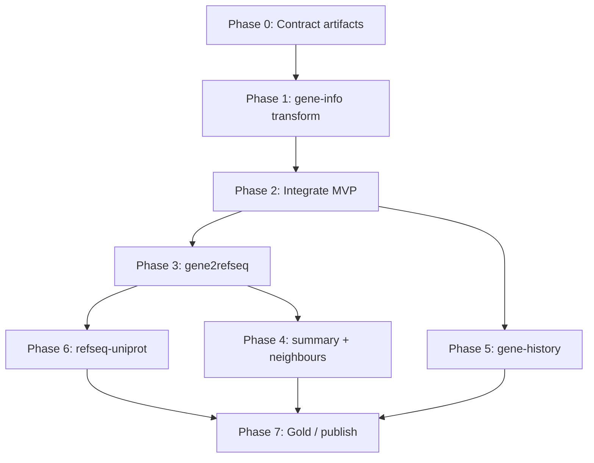

# silicoKG Identity Contract & Implementation Plan

Normative contract for canonical URI minting, silver fragment shape, and integrate merge behavior across NCBI gene sources. Applies the consistent-URI strategy: **mint the same id at transform time when a shared key exists**, keep integrate complexity low, and reserve redirect/crosswalk logic for cases where keys genuinely differ.

**Status:** Draft v1 (post critical review)  
**Scratch notes:** [`_scratch-identity-review-notes.md`](./_scratch-identity-review-notes.md) (temporary)

---

## Decisions (confirmed)

| Topic | Decision |
|-------|----------|
| Gene canonical URI | `silkg:Gene:{tax_id}:{gene_id}` |
| External database xrefs | Emit `GeneHasDbXref` edge fragments with predicate `silkg:SAME_AS` |
| Attribute conflict resolution | ~~Priority table per source (`schemas/integrate-priorities.yaml`), with optional slot-level overrides~~ Policy imposed: source integration ranks must be distinct with no ties |
| Gene synonym handling | Fold into `Gene.synonyms`; do not emit `GeneAliasRecord` nodes |
| Discontinued GeneIDs | Integrate redirect table — **not** `SAME_AS` edges |

---

## 1. Identity strategy

### 1.1 When to use consistent URIs

Use transform-time canonical URIs when every contributing source carries the same stable key in Bronze:

| Entity | Shared key | Sources |
|--------|------------|---------|
| Gene | `(tax_id, gene_id)` | gene-info, gene2refseq, gene-summary, gene-neighbours, gene-group, gene-history |
| Chromosome | `(tax_id, chromosome)` | gene-info |
| RefSeq transcript/protein | accession string | gene2refseq, refseq-uniprot |
| UniProt protein | accession string | refseq-uniprot |

### 1.2 When to use integrate-time redirect

| Case | Mechanism |
|------|-----------|
| Discontinued → current GeneID | Redirect pre-pass + `resolution_report.json` |
| Future non-NCBI sources without `gene_id` | Stub URI + SSSOM crosswalk resolver (out of v1 scope) |

### 1.3 Tradeoffs accepted

| Gain | Cost |
|------|------|
| Identity merge is free across NCBI sources | URI formula changes require re-transform |
| Edges attach immediately at integrate | Wrong shared key → silent wrong merge |
| One canonical Gene node enriched from many sources | Transforms must follow namespace authority rules |
| Simple downstream graph queries | Partial integrate runs yield attribute-sparse nodes until authority source merges |

---

## 2. Prefix & predicate registry

### 2.1 `schemas/prefixes.yaml` (new)

| Prefix | Namespace IRI | Usage |
|--------|-----------------|-------|
| `silkg` | `https://w3id.org/silicokg/` | silicoKG-owned entities and predicates |
| `NCBITaxon` | `http://purl.obolibrary.org/obo/NCBITaxon_` | Taxon references on nodes |
| `HGNC` | `https://www.genenames.org/data/gene-symbol-usage/#!/hgnc/` | Human gene authority xrefs |
| `Ensembl` | `https://www.ensembl.org/id/` | Ensembl gene xrefs |
| `RefSeq` | `https://www.ncbi.nlm.nih.gov/nuccore/` | RNA/DNA accessions |
| `RefSeq` (protein) | `https://www.ncbi.nlm.nih.gov/protein/` | Protein accessions |
| `UniProt` | `https://purl.uniprot.org/uniprot/` | Protein xrefs |

**Migration:** Align domain schema (`schemas/domain/`) to `silkg` default prefix. Retire `path-walker` drift.

### 2.2 `schemas/predicates.yaml` (new)

| Predicate | Meaning |
|-----------|---------|
| `silkg:SAME_AS` | Cross-reference between a silicoKG node and an external CURIE (dbxref, RefSeq↔UniProt) |
| `silkg:HAS_GENE` | Chromosome → Gene membership |
| `silkg:HAS_TRANSCRIPT` | Gene → RefSeq RNA |
| `silkg:ENCODES_PROTEIN` | Transcript → RefSeq protein |
| `silkg:GENOMIC_NEIGHBOR_OF` | Gene → Gene neighbour |

**Note:** `silkg:SAME_AS` is a silicoKG edge label for xref triples. It is not OWL `owl:sameAs` node collapse at merge time. External CURIEs (e.g. `HGNC:5`) remain edge endpoints unless a future source materializes them as nodes.

---

## 3. Entity URI formulas

### 3.1 silicoKG-owned nodes

| Entity | URI | Example |
|--------|-----|---------|
| Gene | `silkg:Gene:{tax_id}:{gene_id}` | `silkg:Gene:9606:1` |
| Chromosome | `silkg:Chromosome:{tax_id}:{chromosome}` | `silkg:Chromosome:9606:19` |
| ChromosomeHasGene | `silkg:ChromosomeHasGene:{tax_id}:{chromosome}:{gene_id}` | `silkg:ChromosomeHasGene:9606:19:1` |
| GeneHasDbXref | `silkg:GeneHasDbXref:{tax_id}:{gene_id}:{normalized_xref}` | `silkg:GeneHasDbXref:9606:1:HGNC:5` |
| GenomicSequence | `silkg:GenomicSequence:{tax_id}:{accession}` | `silkg:GenomicSequence:9606:NC_000019.10` |
| GenomicSequenceMapsGene | `silkg:GenomicSequenceMapsGene:{tax_id}:{accession}:{gene_id}` | `silkg:GenomicSequenceMapsGene:9606:NC_000019.10:1` |
| ChromosomeRepresentedBy | `silkg:ChromosomeRepresentedBy:{tax_id}:{chromosome}:{accession}` | `silkg:ChromosomeRepresentedBy:9606:19:NC_000019.10` |

RefSeq **genomic** accessions (NC_/NG_/NW_/NT_) are `GenomicSequence` nodes, not genes. A gene's placement on a sequence is the `GenomicSequenceMapsGene` edge (`MAPS_TO`, coordinates on the edge); cytogenetic membership stays `ChromosomeHasGene` (`HAS_GENE`); a chromosome links to its assembly contigs via `ChromosomeRepresentedBy` (`REPRESENTED_BY`). `SAME_AS` is reserved for identity equivalence and must never carry a genomic-contig subject.

All formulas in a transform spec that reference Gene or Chromosome endpoints **must** use the same scoped forms. Partial updates (Gene scoped, Chromosome not) are invalid.

### 3.2 External sequence entities

| Entity | URI | Authority source |
|--------|-----|------------------|
| RefSeq RNA | `RefSeq:{rna_nucleotide_accession_version}` | ncbi-gene2refseq |
| RefSeq protein | `RefSeq:{protein_accession_version}` | ncbi-gene2refseq |
| UniProt | `UniProt:{accession}` | ncbi-gene-refseq-to-uniprot |

Version suffixes are part of the identity. Accession version bumps create new nodes.

### 3.3 Dbxref normalization

Bronze `dbxrefs` values are normalized before URI minting:

| Raw | Normalized |
|-----|------------|
| `HGNC:HGNC:5` | `HGNC:5` |
| `Ensembl:ENSG00000121410` | `Ensembl:ENSG00000121410` |
| `MIM:138670` | `OMIM:138670` (or quarantine if unmapped) |
| Unparseable | Quarantine line; do not emit edge |

Unmapped prefix patterns are listed in the contract test fixtures.

### 3.4 `@type` contract

| URI pattern | Required `@type` |
|-------------|------------------|
| `silkg:Gene:*` | `Gene` |
| `silkg:Chromosome:*` | `Chromosome` |
| `silkg:ChromosomeHasGene:*` | `ChromosomeHasGene` |
| `silkg:GeneHasDbXref:*` | `GeneHasDbXref` |
| `silkg:GenomicSequence:*` | `GenomicSequence` |
| `silkg:GenomicSequenceMapsGene:*` | `GenomicSequenceMapsGene` |
| `silkg:ChromosomeRepresentedBy:*` | `ChromosomeRepresentedBy` |
| `RefSeq:NM_*` | `mRNA` (or `Transcript`) |
| `RefSeq:NP_*` | `Protein` |

Same `id`, different `@type` → **quarantine** (never merge).

### 3.5 Retired patterns

| Pattern | Reason |
|---------|--------|
| `silkg:Gene:{gene_id}` (no tax_id) | Ambiguous; breaking change from current silver |
| `GeneAliasRecord` as node | Same `id` as Gene with different `@type` breaks integrate |
| Bare predicate strings (`HAS_GENE`) | Must be namespaced |
| `silkg:Gene:{tax_id}:{NC_/NG_/NW_/NT_ accession}` | Genomic accession is a `GenomicSequence`, not a gene identity |
| `GeneSameAsGene` with a genomic-contig subject | Location ≠ `SAME_AS`; use `GenomicSequenceMapsGene` (`MAPS_TO`) |
| `GeneSameAsGene` id without `{gene_id}` | Caused 17k-way id collisions on shared contigs |

### 3.6 CORUM protein complexes

Source `corum-human-complexes` mints external-style `CORUM:` CURIEs for complexes and Functional Complex Groups (FCGs), plus `silkg:` ids for evidence and reified edges. Proteins reuse the UniProt-accession identity shared with UniProt GAF.

| Entity / edge | URI | Example |
|--------|-----|---------|
| ProteinComplex | `CORUM:{complex_id}` | `CORUM:1` |
| AnnotatedEvidence | `silkg:AnnotatedEvidence:corum:{complex_id}` | `silkg:AnnotatedEvidence:corum:1` |
| GeneGroup (FCG) | `CORUM:FCG{fcg_id}` | `CORUM:FCG16` |
| Protein (stub / join) | `silkg:Protein:9606:{uniprot_id}` | `silkg:Protein:9606:P41182` |
| ProteinMemberOfComplex | `silkg:ProteinMemberOfComplex:9606:{uniprot_id}:{complex_id}` | `silkg:ProteinMemberOfComplex:9606:P41182:1` |
| ProteinComplexHasEvidence | `silkg:ProteinComplexHasEvidence:{complex_id}` | `silkg:ProteinComplexHasEvidence:1` |
| ProteinComplexGOAssociation | `silkg:ProteinComplexGO:{complex_id}:{predicate}:{go_id}` | `silkg:ProteinComplexGO:1:silkg:HAS_FUNCTION:GO:0004407` |
| ProteinComplexMemberOfGeneGroup | `silkg:ProteinComplexMemberOfFCG:{complex_id}:{fcg_id}` | `silkg:ProteinComplexMemberOfFCG:36:16` |
| GeneGroupBroadMatchGO | `silkg:GeneGroupBroadMatchGO:FCG{fcg_id}:{go_id}` | `silkg:GeneGroupBroadMatchGO:FCG16:GO:0016192` |

Predicates by CORUM GO aspect: `molecular_function` → `silkg:HAS_FUNCTION` (`silkg:MolecularFunction:{go_id}`), `cellular_component` → `silkg:ACTIVE_IN` (`silkg:CellComponent:{go_id}`), `biological_process` → `silkg:PARTICIPATES_IN` (`silkg:BiologicalProcess:{go_id}`). FCG→GO uses `silkg:BROAD_MATCH`; complex→evidence uses `silkg:HAS_EVIDENCE`; membership edges use `silkg:MEMBER_OF`.

**FCG id collision rule:** FCG ids and complex ids share the same integer space (e.g. both `16` occur). FCG GeneGroups **must** be minted as `CORUM:FCG{fcg_id}`, never `CORUM:{fcg_id}`, so `CORUM:16` (a complex) and `CORUM:FCG16` (a group) stay distinct nodes.

CORUM-minted nodes (`ProteinComplex`, `AnnotatedEvidence`, FCG `GeneGroup`) carry `class_labels: [silkg:CORUM]`, projecting the Neo4j label `CORUM`. Member Proteins gain `class_labels: [silkg:Subunit]` at classify time (label `Subunit`); they keep `@type: Protein` and are not CORUM-sourced nodes.

---

## 4. Silver fragment contract

Each line in `universe/{run_id}/3-silver/{source_name}/fragments.jsonl`:

```json
{
  "class": "Gene",
  "object": {
    "id": "silkg:Gene:9606:1",
    "symbol": "A1BG",
    "name": "alpha-1-B glycoprotein",
    "tax_id": "NCBITaxon:9606",
    "synonyms": ["A1B", "ABG", "GAB"],
    "dbxrefs": ["HGNC:5", "Ensembl:ENSG00000121410"],
    "@type": "Gene"
  },
  "source": {
    "source_name": "ncbi-gene-info",
    "silver_run_id": "2026-07-18T13:12:45.528080+00:00",
    "bronze_line": 0,
    "gene_id": "1",
    "tax_id": "9606"
  }
}
```

`GeneHasDbXref` example:

```json
{
  "class": "GeneHasDbXref",
  "object": {
    "id": "silkg:GeneHasDbXref:9606:1:HGNC:5",
    "subject": "silkg:Gene:9606:1",
    "predicate": "silkg:SAME_AS",
    "object": "HGNC:5",
    "@type": "GeneHasDbXref"
  },
  "source": {
    "source_name": "ncbi-gene-info",
    "silver_run_id": "2026-07-18T13:12:45.528080+00:00",
    "bronze_line": 0,
    "gene_id": "1",
    "tax_id": "9606"
  }
}
```

**Required envelope fields:** `class`, `object.id`, `object.@type`, `source.source_name`, `source.bronze_line`, and at least one stable bronze key in `source`.

**Fan-out rule:** One bronze row may yield 1 Gene fragment + N `GeneHasDbXref` fragments + other derivations. Fan-out is implemented in the transform engine (LinkML-Map alone emits one object per derivation).

**Gene.dbxrefs attribute:** Emit both the attribute list on `Gene` **and** `GeneHasDbXref` edges. Attribute supports tabular access; edges support graph traversal.

---

## 5. Integrate contract (Stage 4)

### 5.1 Scope

Integrate is a **run-level** stage. It reads all selected `3-silver/{source}/fragments.jsonl` under a `run_id` and writes:

```
universe/{run_id}/4-merged/nodes.jsonl
universe/{run_id}/4-merged/edges.jsonl
universe/{run_id}/4-merged/quarantine.jsonl
universe/{run_id}/4-merged/resolution_report.json
universe/{run_id}/4-merged/manifest.json
```

**Orchestrator note:** `pipeline/run/runner.py` currently invokes every stage per source. Integrate must be extracted to a run-level handler that executes once after all source transforms complete.

### 5.2 Node identity & merge

**Key:** `(object.id, object.@type)`

**Scalar attributes:** Walk sources in priority order (see §5.4). Take the first non-empty value from the highest-priority source that contributes the fragment. If a lower-priority source has a different non-empty value, record it in `alternates`:

```json
{
  "id": "silkg:Gene:9606:1",
  "@type": "Gene",
  "symbol": "A1BG",
  "alternates": [
    {"slot": "name", "value": "...", "source": "ncbi-gene-summary"}
  ],
  "sources": [
    {"source_name": "ncbi-gene-info", "silver_run_id": "...", "bronze_line": 0}
  ]
}
```

**Multivalued attributes** (`synonyms`, `dbxrefs`): Set union across all sources regardless of priority.

**Provenance:** Append `{source_name, silver_run_id, bronze_line}` to `sources[]` for every contributing fragment.

### 5.3 Edge identity & merge

**Dedup key:** `( @type, subject, predicate, object )` — edge `id` is not used for dedup.

**Payload:** First contribution in stream order owns every non-key slot (`start`, `end`, `map_location`, `id`, …). Later fragments append `{source_name, silver_run_id, bronze_line}` to `sources[]` only. Source rank (`§5.4`) is not consulted. Edges do not grow `alternates[]`.

Disagreements on non-empty payload slots are counted in `resolution_report.json` (`edge_payload_conflicts`, bounded `edge_payload_conflict_samples`). They do not quarantine the run. See [edge-merge-policy.md](./edge-merge-policy.md).

A different `subject` or `object` is a different edge, not a payload conflict.

Classify as edges: `ChromosomeHasGene`, `GeneHasDbXref`, `GeneHasTranscript`, `ProteinSameAs`, `GeneAdjacentToGene`, and other reified triple classes.

External CURIEs appearing only as edge objects (e.g. `HGNC:5`) are not merged as nodes in v1.

### 5.4 Priority table

File: `schemas/integrate-priorities.yaml`

```yaml
# Higher rank wins for scalar slot conflicts
sources:
  ncbi-gene-info: 100
  ncbi-gene-summary: 90
  ncbi-gene2refseq: 50
  ncbi-gene-neighbours: 40
  ncbi-gene-group: 40
  ncbi-gene-history: 30
  ncbi-gene-refseq-to-uniprot: 20

slots:
  Gene:
    description: [ncbi-gene-summary, ncbi-gene-info]
    name: [ncbi-gene-info, ncbi-gene-summary]
    symbol: [ncbi-gene-info]
```

**Algorithm:**

1. If `slots.{Class}.{slot}` exists, use that ordered source list.
2. Else sort contributing sources by `sources.{name}` rank descending.
3. First non-empty wins; lower-priority conflicts → `alternates`.

Manifest file order is **not** used.

### 5.5 Gene-history redirect (Phase 5)

Discontinued GeneIDs use a redirect pre-pass, not `SAME_AS`:

1. Load redirect pairs from `ncbi-gene-history` silver (`GeneIdentityRedirect` fragments or dedicated redirect artifact).
2. Rewrite any edge `subject` / `object` matching `silkg:Gene:{tax_id}:{discontinued_id}` → `silkg:Gene:{tax_id}:{current_id}`.
3. Log each rewrite in `resolution_report.json` under `redirects[]`.
4. Do not merge discontinued and current Gene node bodies — redirect endpoints only.

### 5.6 Quarantine triggers

- Same `id`, different `@type`
- URI fails prefix validation
- Redirect cycle detected
- Required envelope fields missing
- Unparseable dbxref emitted despite fan-out guard

---

## 6. Source obligations

| Source | Emits | Gene URI reference |
|--------|-------|-------------------|
| ncbi-gene-info | Gene, Chromosome, ChromosomeHasGene, GeneHasDbXref | Authority — mints canonical Gene |
| ncbi-gene2refseq | Transcript, Protein, GeneHasTranscript, TranscriptEncodesProtein | `silkg:Gene:{tax_id}:{gene_id}` |
| ncbi-gene-summary | Gene (text enrichment) | Same Gene URI |
| ncbi-gene-neighbours | GeneAdjacentToGene | Both endpoints use canonical Gene URI |
| ncbi-gene-group | GeneInGroup | Gene URI |
| ncbi-gene-history | GeneIdentityRedirect | Discontinued + current Gene URIs |
| ncbi-gene-refseq-to-uniprot | ProteinSameAs | `RefSeq:` ↔ `UniProt:` with `silkg:SAME_AS` |

---

## 7. Implementation plan (8 phases)



---

### Phase 0 — Contract artifacts

**Goal:** Make identity rules testable and authoritative before changing silver output.

**Deliverables**

| File | Purpose |
|------|---------|
| `schemas/prefixes.yaml` | Prefix registry |
| `schemas/predicates.yaml` | Predicate CURIEs including `silkg:SAME_AS` |
| `schemas/integrate-priorities.yaml` | Source rank + slot overrides |
| `schemas/domain/gene-or-gene-product.yaml` | Add `GeneHasDbXref`, `tax_id`, `dbxrefs`; migrate to `silkg` |
| `pipeline/README.md` | Universe tier layout; document integrate as run-level |
| `pipeline/integrate/tests/fixtures/uri-golden.yaml` | Bronze row → expected CURIEs (A1BG anchor) |

**Tasks**

- [ ] Add `GeneHasDbXref` reified triple class to domain schema
- [ ] Document fan-out derivations as transform engine responsibility
- [ ] Document dbxref normalization table (§3.3)
- [ ] Flag orchestrator change: integrate is run-scoped, not per-source
- [ ] Write golden URI tests (no silver re-materialization yet)

**Exit criteria:** Contract tests pass on paper examples; domain schema validates.

**Critical review notes:** Phase 0 must land `GeneHasDbXref` and priority schema before Phase 1 changes output shape. Orchestrator flaw (per-source integrate) must be documented here to avoid rework in Phase 2.

---

### Phase 1 — Fix ncbi-gene-info transform

**Goal:** Emit contract-compliant silver from the one live source.

**Files:** `ncbi-gene-info.transform.yaml`, `pipeline/transform/runner.py`, `pipeline/transform/engine.py`, ingest adapter

**Tasks**

- [ ] Adopt silver fragment envelope in `runner.py` (`class` / `object` / `source`)
- [ ] Update URI expressions: Gene, Chromosome, ChromosomeHasGene (tax_id scoped)
- [ ] Remove `GeneAliasRecord` derivation; normalize synonyms in adapter → `Gene.synonyms`
- [ ] Parse and normalize `dbxrefs` on Gene object
- [ ] Implement dbxref fan-out in engine: 1 bronze row → N `GeneHasDbXref` fragments
- [ ] Namespace predicates (`silkg:HAS_GENE`, `silkg:SAME_AS`)
- [ ] Fix quarantine line shape (structured, not raw bronze passthrough)
- [ ] Re-materialize silver; update manifest counts

**Exit criteria**

- No fragment pairs share `id` with different `@type` for Gene
- A1BG bronze row produces Gene + ChromosomeHasGene + one `GeneHasDbXref` per normalized xref
- Envelope validates against documented schema
- Fragment count documented (~194k genes + ~780k xref edges + location edges)

**Critical review notes**

- LinkML-Map cannot fan out dbxrefs declaratively — engine post-step is required (Phase 1 blocker if skipped).
- Breaking change: existing flat silver under `universe/*/3-silver/` is invalid after this phase.
- Synonym dedup belongs in adapter, not transform expr.

---

### Phase 2 — Integrate stage MVP

**Goal:** Merge single-source gene-info silver into `4-merged/`.

**New package:** `pipeline/integrate/` (mirror validate/transform layout)

```
pipeline/integrate/
  cli.py, context.py, runner.py, engine.py
  merge.py          # priority-aware node merge
  classify.py       # node vs edge fragment routing
  quarantine.py
  tests/
```

**Tasks**

- [ ] Implement streaming fragment reader (envelope-aware)
- [ ] Classify fragments into node vs edge buckets by `@type`
- [ ] Node merge on `(id, @type)` with priority table
- [ ] Edge dedup on `( @type, subject, predicate, object )`
- [ ] Write merged artifacts + manifest
- [ ] Add run-level integrate handler to `pipeline/run/runner.py` (not per-source)
- [ ] CLI: `python -m pipeline.integrate.cli --run-id ... --priorities schemas/integrate-priorities.yaml`

**Exit criteria**

- Single-source gene-info integrate produces ~194k Gene nodes, zero quarantine
- Re-run is deterministic (same input → same output)
- `alternates[]` populated when test fixture injects conflicting scalar from lower-priority mock source

**Critical review notes**

- At ~1.5M fragments, use streaming merge; avoid loading all nodes into RAM without a spill strategy.
- Phase 2 validates merge logic only; multi-source wiring lands in Phase 3.

---

### Phase 3 — ncbi-gene2refseq

**Goal:** First multi-source integrate; prove consistent Gene URIs across sources.

**Tasks**

- [ ] Ingest adapter + validate for gene2refseq (schema exists)
- [ ] Transform spec: `RefSeq:` entities + edges referencing `silkg:Gene:{tax_id}:{gene_id}`
- [ ] Add domain classes: `GeneHasTranscript`, `TranscriptEncodesProtein` (or equivalent)
- [ ] Integrate gene-info + gene2refseq in one run
- [ ] Verify: one Gene node per id; RefSeq nodes and edges attach without resolver

**Exit criteria:** Query path "RefSeq proteins for A1BG" traverses `silkg:Gene:9606:1` without duplicate Gene nodes.

**Critical review notes:** gene2refseq row volume >> gene-info. Edge dedup and streaming merge must be tested at scale. gene2refseq should not compete with gene-info on Gene scalar attributes (edges only).

---

### Phase 4 — gene-summary + gene-neighbours

**Goal:** Attribute enrichment and neighbour edges with priority overrides.

**Tasks**

- [ ] Ingest + transform for gene-summary and gene-neighbours
- [ ] gene-summary: same Gene URI; enrich `description`
- [ ] gene-neighbours: `GeneAdjacentToGene` with canonical Gene endpoints
- [ ] Confirm slot override: `Gene.description` prefers gene-summary
- [ ] Multi-source integrate with priority table validation

**Exit criteria:** Merged A1BG `description` comes from gene-summary; `sources[]` lists both gene-info and gene-summary.

**Critical review notes:** Add `Gene.description` slot override to priority file before testing. Neighbour edges are directed as in source — dedup only on full edge key.

---

### Phase 5 — gene-history

**Goal:** Discontinued GeneID redirect without polluting SAME_AS xref semantics.

**Tasks**

- [ ] Fix `discontinue_date::` typo in `ncbi-gene-history.schema.yaml`
- [ ] Ingest + transform emitting `GeneIdentityRedirect` fragments
- [ ] Implement integrate redirect pre-pass (`redirect.py`)
- [ ] Rewrite edge endpoints; log in `resolution_report.json`
- [ ] Test: edge at discontinued URI attaches to canonical Gene

**Exit criteria:** No standalone nodes for discontinued IDs when history source is included; redirects logged.

**Critical review notes:** Keep redirect separate from `GeneHasDbXref` / `SAME_AS`. History is identity correction, not external db cross-reference.

---

### Phase 6 — refseq-uniprot

**Goal:** Cross-database protein linking with consistent predicate.

**Tasks**

- [ ] Ingest + transform for refseq-uniprot
- [ ] Emit `ProteinSameAs` edges: `RefSeq:` ↔ `UniProt:` with `silkg:SAME_AS`
- [ ] Integrate with gene2refseq RefSeq nodes from Phase 3
- [ ] Optional QA: compare gene-info dbxrefs against uniprot mappings

**Exit criteria:** RefSeq protein nodes from gene2refseq gain UniProt edges after integrate.

---

### Phase 7 — Gold / publish

**Goal:** Consumer-ready projection from merged tier.

**Tasks**

- [ ] `pipeline/publish/` package: merged → gold projection
- [ ] Optional LinkML validation against domain schema
- [ ] CURIE expansion via `prefixes.yaml` for RDF/Neo4j export
- [ ] Wire `_run_publish` in orchestrator (run-level)
- [ ] Quarantine split to `5-gold/quarantine/`

**Exit criteria:** Gold nodes/edges pass domain validation; publish manifest records projection rules.

**Critical review notes:** External xref CURIEs may remain edge-only in gold until dedicated source ingestion is added.

---

## 8. Test strategy

| Phase | Test |
|-------|------|
| 0 | Golden URI fixtures (bronze → CURIE) |
| 1 | Transform fixture: A1BG → envelope fragments + xref edge count |
| 2 | Single-source integrate determinism + priority/alt fixture |
| 3 | Two-source merge: no duplicate Gene nodes |
| 4 | Slot override: description from gene-summary |
| 5 | Redirect: discontinued endpoint rewrite |
| 6 | RefSeq ↔ UniProt edge presence |
| 7 | Gold validates against domain schema |

**Regression anchor:** A1BG (`tax_id: 9606`, `gene_id: 1`) end-to-end through all phases.

---

## 9. Current state vs target

| Aspect | Today | Target |
|--------|-------|--------|
| Gene URI | `silkg:Gene:1` | `silkg:Gene:9606:1` |
| Dbxrefs | Ignored | `Gene.dbxrefs` + `GeneHasDbXref` / `silkg:SAME_AS` edges |
| Synonyms | Separate `GeneAliasRecord` node | On `Gene.synonyms` |
| Silver shape | Flat JSON + `@type` | Envelope with provenance |
| Integrate | Not implemented | Priority merge + redirect pass |
| Orchestrator integrate | N/A (per-source loop) | Run-level stage |

---

## 10. References

- Universe paths: `pipeline/paths.py`
- Transform engine: `pipeline/transform/engine.py`
- Current transform spec: `sources/ncbi/ncbi_gene_info/ncbi-gene-info.transform.yaml`
- Transform performance plan: `docs/plans/transform-performance-and-silver.md`
- Critical review scratch notes: `docs/plans/_scratch-identity-review-notes.md`
