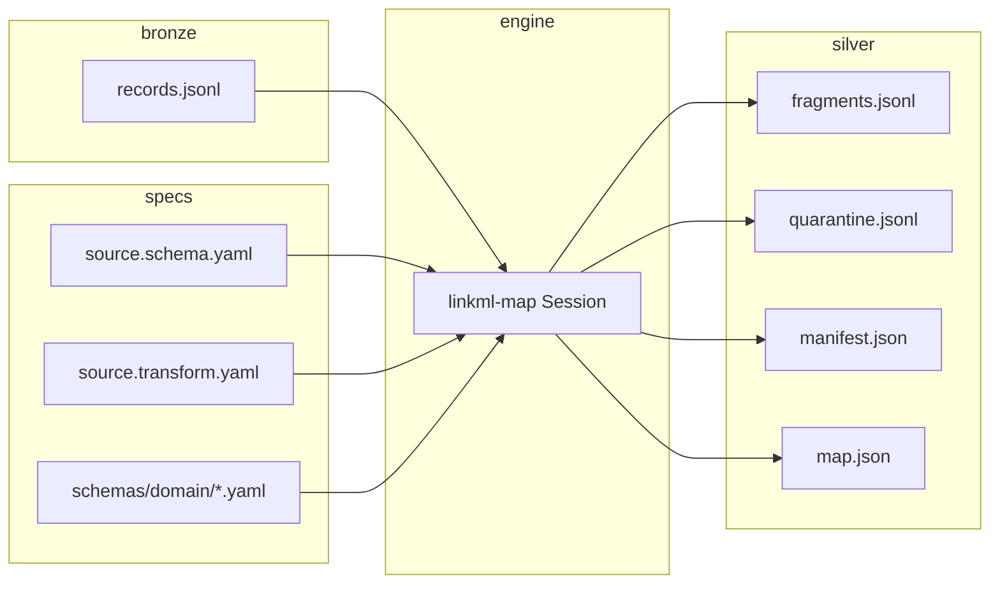

# LinkML-Map transformation stage — skeleton implementation plan

Plan for the **transform** pipeline stage: map validated **bronze** source records into **silver** domain **fragments** using [LinkML-Map](https://linkml.io/linkml-map/) (`TransformationSpecification` YAML + `linkml-map` Python API).

## Context

| Layer | Role today | Key paths (`pipeline/paths.py`) |
| --- | --- | --- |
| Staging | Ingest (publisher → normalized rows) | `universe/{run_id}/1-staging/{source_name}/records.jsonl` |
| Bronze | Validate (LinkML source schema) | `universe/{run_id}/2-bronze/{source_name}/records.jsonl` |
| Silver | **Transform (this plan)** | `fragments.jsonl`, `map.json`, `quarantine.jsonl`, `manifest.json` |

Per-source artifacts (convention already in repo):

- **Source schema:** `sources/{source}/{module}/{source_name}.schema.yaml` — input model (e.g. `NCBIGeneInfoRow`).
- **Transform spec:** `sources/{source}/{module}/{source_name}.transform.yaml` — LinkML-Map mapping to domain classes.
- **Domain schema:** `schemas/domain/*.yaml` — target model (e.g. `Gene` in `gene-or-gene-product.yaml`).

Orchestration hook (not wired yet): `pipeline/run/runner.py` → `_run_transform`.

---

## Goals

1. Stream bronze `records.jsonl` and emit silver `fragments.jsonl` (one JSON object per line per mapped fragment).
2. Keep mappings **declarative** in `{source_name}.transform.yaml` (no per-source Python transform logic unless unavoidable).
3. Record provenance: which transform spec / schemas were used (`manifest.json`, optional `map.json` snapshot).
4. Quarantine rows that fail mapping or post-map validation without failing the whole run (policy TBD).
5. Expose `python -m pipeline.transform.cli` and integrate with `pipeline.run` YAML stages.

## Non-goals (initial slice)

- SQL/DuckDB compilation backend.
- Merge / integrate / publish tiers.
- Auto-generating transform specs from source schemas only (may use `linkml-map derive-schema` as a dev aid later).

---

## Dependencies

- [ ] Add `linkml-map` to project dependencies (not in venv today).
- [ ] Pin compatible `linkml` / `linkml-runtime` versions with existing validate stack.
- [ ] Document `--unrestricted-eval` policy if transform specs use Python `expr` (security vs. flexibility).

---

## Package layout (mirror `pipeline/validate`)

```
pipeline/transform/
  __init__.py
  __main__.py
  cli.py              # argparse → runner.run
  context.py          # TransformContext dataclass
  runner.py           # I/O dirs, manifest, invoke engine
  engine.py           # linkml-map session / per-record transform
  errors.py           # optional typed errors
  README.md           # usage + I/O contract
  tests/
    test_engine.py    # fixture bronze row → expected fragment
    test_runner.py    # temp universe dirs
```

---

## Implementation phases

### Phase 0 — Design decisions

- [ ] **Fragment shape:** document JSONL line schema (e.g. `{ "class": "Gene", "object": { ... }, "source": { "source_name", "gene_id", "bronze_line" } }`).
- [ ] **Target schema resolution:** explicit path in transform YAML vs. derived implicit schema via `Session.target_schema()`.
- [ ] **One row → many fragments:** support `class_derivations` that emit nested or multiple objects (e.g. Gene + Chromosome edges later).
- [ ] **Failure policy:** fail-fast vs. quarantine + exit code 1 if any quarantine (match validate/ingest semantics).
- [ ] **Input linkage:** `--bronze-run-id` default = `--run-id`; allow validating staging from a different run id (same pattern as validate’s `staging_run_id`).

### Phase 1 — Transform spec for first source (`ncbi-gene-info`)

- [ ] Author `sources/ncbi/ncbi_gene_info/ncbi-gene-info.transform.yaml`:
  - `class_derivations` from `NCBIGeneInfoRow` → domain `Gene` (minimal slots: `id`, `name`, `description`, `synonyms`).
  - Slot expressions for identifiers (e.g. CURIE from `gene_id`), synonym lists, type filtering if needed.
- [ ] Run locally: `linkml-map validate-spec -T ...` and `linkml-map map-data -T ... -s ...` on a single bronze record (smoke test).
- [ ] Optional: `linkml-map derive-schema` to diff against `schemas/domain/gene-or-gene-product.yaml`.

### Phase 2 — Engine (`engine.py`)

- [ ] Load source schema path via `UniversePaths.source_schema_path_for(source, source_name)`.
- [ ] Load transform path via `UniversePaths.transform_schema_path_for(source, source_name)`.
- [ ] Construct LinkML-Map `Session` (or equivalent) with source schema + transform spec + target schema import path.
- [ ] API sketch:
  - `transform_record(record: dict) -> TransformOutcome` (`fragments: list[dict]`, `errors: list[str]`)
  - `transform_stream(records: Iterator[dict]) -> Iterator[TransformOutcome]`
- [ ] Handle multivalued / null fields consistently with bronze JSON (already normalized in ingest).

### Phase 3 — Runner (`runner.py`)

- [ ] `TransformContext`: `run_id`, `bronze_run_id`, `source`, `source_name`, `target_class` (source row class), `paths`.
- [ ] Ensure `universe/{run_id}/3-silver/{source_name}/` exists.
- [ ] Read `paths.bronze_records(source_name, bronze_run_id)`.
- [ ] Write `paths.silver_fragments(source_name, run_id)`.
- [ ] Write `paths.silver_quarantine(source_name, run_id)` for failed rows (include original record + error detail).
- [ ] Write `paths.silver_map(source_name, run_id)` — transform spec metadata (hash, paths, derived target class list, linkml-map version).
- [ ] Write `paths.silver_manifest(source_name, run_id)`:
  - `stage`: `transform`, `tier`: `silver`
  - counts: input, fragments_written, quarantined
  - schema paths, timestamps, `bronze_run_id`
- [ ] Return process exit code (0 / 1).

### Phase 4 — CLI (`cli.py`)

- [ ] Flags aligned with validate CLI:
  - `--source`, `--source-name`, `--run-id`, `--bronze-run-id`, `--target-class`, `-v`
- [ ] Entry: `PYTHONPATH=. python -m pipeline.transform.cli ...`

### Phase 5 — Orchestration

- [ ] Implement `_run_transform` in `pipeline/run/runner.py` (import `pipeline.transform.runner.run`).
- [ ] Forward `ctx.stage_args.get("transform", {})` (e.g. `bronze_run_id`, eval flags).
- [ ] Uncomment `transform` in `pipeline/run/examples/ncbi-gene-info.yaml`.
- [ ] Wire `_run_validate` while touching orchestrator (currently stubbed).

### Phase 6 — Quality & ops

- [ ] Unit tests with frozen bronze JSONL snippet under `pipeline/transform/tests/fixtures/`.
- [ ] CI job: validate-spec + map-data on fixtures.
- [ ] `pipeline/transform/README.md` with end-to-end example:
  - ingest → validate → transform for `ncbi-gene-info`.
- [ ] Update top-level / pipeline docs referencing universe silver contract.

---

## Data flow (target)



---

## Open questions

1. Should silver fragments be validated against domain LinkML schema immediately (second validator pass) or defer to integrate?
2. How should `map.json` relate to LinkML-Map’s invert/compile outputs — full spec copy, or normalized summary for auditors?
3. Registry: should `sources/registry.py` expose `target_class` + transform path per adapter to avoid duplicating CLI defaults?
4. Version drift: store content hash of transform + source schema in manifest for reproducibility?

---

## Acceptance criteria (MVP)

- [ ] `ncbi-gene-info.transform.yaml` validates with `linkml-map validate-spec`.
- [ ] CLI reads bronze `records.jsonl` and writes silver `fragments.jsonl` + `manifest.json`.
- [ ] At least one integration test proves a known bronze row maps to a `Gene` fragment with expected `id` / `name`.
- [ ] `pipeline.run` can run `stages: [ingest, validate, transform]` for the example YAML without manual path hacking.

---

## References

- LinkML-Map docs: https://linkml.io/linkml-map/
- Tutorial: https://linkml.io/linkml-map/examples/Tutorial/
- CLI: `linkml-map map-data`, `validate-spec`, `derive-schema`
- In-repo patterns: `pipeline/validate/`, `pipeline/ingest/`, `pipeline/paths.py`
