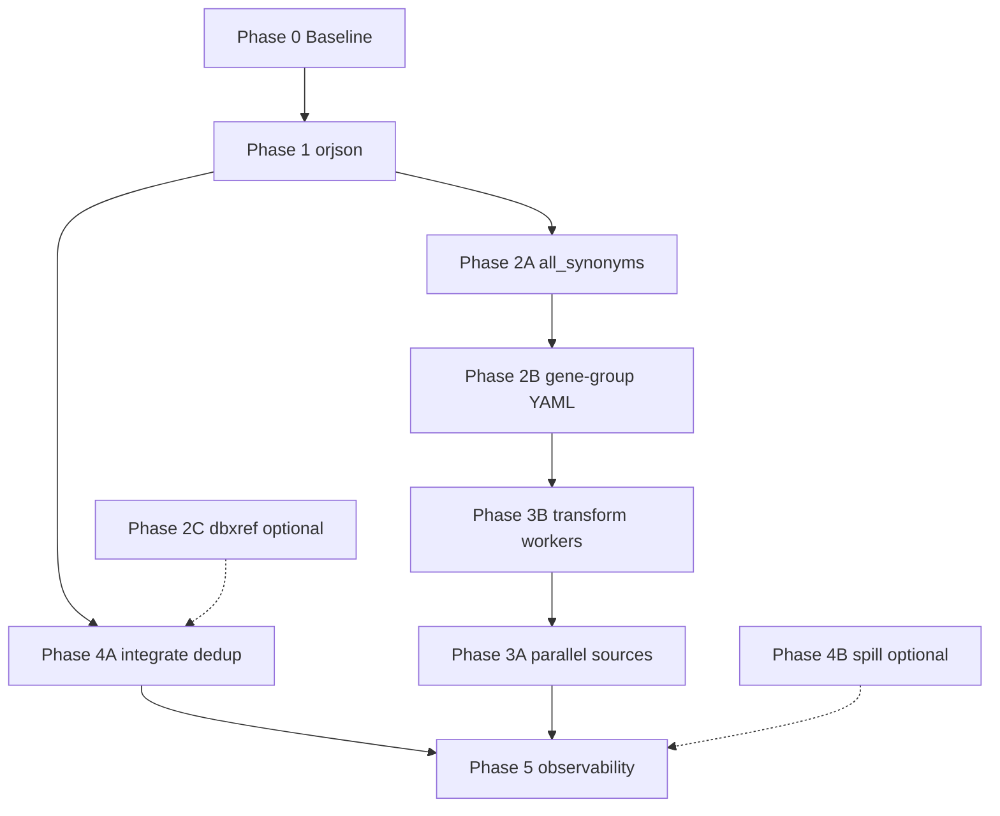

# Execution plan: transform + integrate performance

Baseline target: **`ncbi-gene-info-summary.yaml`** run (`test-x` scale) — ~3.9M silver fragments, integrate ~58s, transform dominated by `ncbi-gene2refseq` + LinkML-Map expression cost.

Related: [transform-performance-and-silver.md](./transform-performance-and-silver.md) (Phases 0–2 largely done; Phases 3–6 open). **Phase numbers in this document are independent** of that plan — this plan extends that work and adds integrate.

---

## Measured baseline (`test-x`, 2026-07-22)

Derived from manifest `started_at` / `finished_at` timestamps (until `duration_seconds` lands in Phase 0).

| Stage | Source / tier | Duration | Fragments / records |
|-------|---------------|----------|---------------------|
| transform | ncbi-gene-info | ~35s | 686,423 fragments / 193,804 bronze rows |
| transform | ncbi-gene-summary | ~5s | 151,658 fragments |
| transform | ncbi-gene-group | ~8s | 45,938 fragments |
| transform | ncbi-gene2refseq | ~233s | 3,041,022 fragments / 849,059 bronze rows |
| transform | **sequential total** | **~282s** | — |
| integrate | merged (4 sources) | **~58s** | 3,925,041 fragments → 1,219,086 nodes + 1,448,860 edges |

**Bottleneck math:** gene2refseq is ~83% of sequential transform wall time. Per-source parallel transform (Phase 3A) caps at ~233s on this workload (~**1.2×**), not ~3×. Multi-core wins for the ≥2× transform goal depend primarily on **intra-source workers on gene2refseq** (Phase 3B).

---

## Goals

| Goal | Success metric |
|------|----------------|
| Cut transform wall time on full 4-source run | ≥2× faster end-to-end transform (~282s → ≤141s); stretch ~4× with Phase 3B on gene2refseq |
| Cut integrate wall time | ≥1.5× faster on `test-x` (~58s → ≤39s) |
| Preserve output correctness | Existing tests + golden diff on `universe/test-small` |
| Keep RAM bounded | Transform streaming unchanged; integrate peak RAM flat or lower (requires Phase 4B if materialization is the limit) |

## Non-goals (this sprint)

- DuckDB/SQL transform backend
- Rewriting LinkML-Map
- Neo4j load tuning (`export_neo4j` / `load.neo4j` are separate)
- Post-silver LinkML validation

---

## Phase 0 — Baseline & guardrails (1 day)

**Purpose:** Lock correctness checks; formalize baseline already captured above.

### Tasks

1. **Confirm baseline timings** on `test-x` (or re-run if bronze/silver drift):
   - Per-source transform: wall time, fragments written, bronze row count (from silver manifests)
   - Integrate: wall time, fragment/node/edge counts (from merged manifest)
2. **Profile hot paths** (save `.prof` files, not committed):

   ```bash
   PYTHONPATH=. python -m cProfile -o transform-gene2refseq.prof \
     -m pipeline.transform.cli --source ncbi --source-name ncbi-gene2refseq \
     --run-id test-x --bronze-run-id test-x --source-row-class NCBIGene2RefseqRow

   PYTHONPATH=. python -m cProfile -o integrate.prof \
     -m pipeline.integrate.cli --run-id test-x \
     --sources ncbi-gene-info ncbi-gene-summary ncbi-gene-group ncbi-gene2refseq
   ```

3. **Define regression fixtures**
   - `universe/test-small` — fast CI gate (already used in `pipeline/transform/tests/`)
   - Snapshot or hash compare: merged `nodes.jsonl` / `edges.jsonl` line counts + spot-check Gene records
4. **Add timing to manifests** (small code change, high value):
   - Include `duration_seconds` in transform + integrate manifests
   - Enables before/after comparison without recomputing from timestamps

### Acceptance

- Baseline numbers documented in PR/issue (table above is the reference)
- `pytest pipeline/transform/tests pipeline/integrate/tests` green

---

## Phase 1 — Shared fast JSON I/O (2–3 days)

**Purpose:** Cheapest cross-cutting win; both stages parse/serialize millions of lines.

### Tasks

1. Add **`orjson`** as a project dependency — create root `requirements.txt` (or `pyproject.toml`) since none exists today; document install in root `README.md`
2. Create **`pipeline/io/jsonl.py`**:
   - `loads_line(line: bytes | str) -> dict`
   - `dumps_line(obj) -> bytes` (+ trailing newline)
   - Single import point for future stages (validate, publish)
3. Wire into:
   - `pipeline/transform/engine.py` — `iter_bronze_records`
   - `pipeline/transform/runner.py` — fragment/quarantine writes
   - `pipeline/integrate/engine.py` — fragment reads
   - `pipeline/integrate/runner.py` — merged output writes
4. Tests: fixture round-trip; integrate/transform tests unchanged in behavior

### Expected impact

~20–40% on JSON-heavy portions of integrate (~58s baseline); modest but measurable on transform write path. Transform CPU (`map_object`) remains the dominant cost for gene2refseq.

### Acceptance

- Identical silver/merged output on `test-small` fixtures
- Manifest shows lower `duration_seconds` vs Phase 0 baseline

---

## Phase 2 — Transform expression hot paths (3–5 days)

**Purpose:** Attack CPU-bound `map_object` / `eval_expr` — the dominant transform cost.

Synonyms live on **`Gene.synonyms`** (not a separate `GeneAliasRecord` class — see [identity-contract.md](./identity-contract.md)).

### Track 2A — Bronze `all_synonyms` (gene-info) — do first

| Step | File(s) |
|------|---------|
| Add `all_synonyms` to source schema | `sources/ncbi/ncbi_gene_info/ncbi-gene-info.schema.yaml` |
| Merge in adapter normalize | `sources/ncbi/ncbi_gene_info/adapter.py` (extend `_normalize_row` or subclass hook) |
| Simplify transform YAML | `sources/ncbi/ncbi_gene_info/ncbi-gene-info.transform.yaml` — `Gene.synonyms: populated_from: all_synonyms` |
| Re-ingest bronze for benchmark run id | ingest + validate for `test-x` or new `perf-baseline` run |
| Assert `Gene.synonyms` parity | extend `pipeline/transform/tests/test_engine.py` |

Document dedupe/order policy in adapter docstring; note in manifest if semantics change.

### Track 2B — Shorten gene-group expressions

| Step | File(s) |
|------|---------|
| Audit repeated `case(...)` blocks | `sources/ncbi/ncbi_gene_group/ncbi-gene-group.transform.yaml` |
| Extract shared logic to bronze computed fields **or** consolidate derivations where LinkML-Map allows | adapter + schema + transform YAML |
| Fixture test for one representative gene-group row | `pipeline/transform/tests/` |

### Track 2C — Optional: defer dbxref edge fan-out

`GeneHasDbXref` edges multiply silver volume (~integrate cost). Options (pick one):

- **A.** Emit dbxrefs only on `Gene` node; derive edges at publish — **requires new publish projection logic** (publish today strips `dbxrefs`/`same_as` from gold nodes and excludes `GeneHasDbXref` edges; it does not project edges from node dbxrefs)
- **B.** Keep edges but gate behind transform flag `--emit-dbxref-edges` (default on for prod)

Only pursue if profiling shows dbxref edges are a top integrator cost *after* Phase 1. On `test-x`, gene2refseq fragments dominate integrate I/O (~78% of fragments).

### Acceptance

- `Gene.synonyms` (and other Gene slots) match baseline on frozen bronze fixtures
- Profile: measurable drop in `eval_expr` time on 10k gene-info rows
- gene-info transform time ↓ without changing gene2refseq

---

## Phase 3 — Transform parallelism (4–6 days)

**Purpose:** Use multiple cores. **Prioritize 3B (gene2refseq workers) for the ≥2× transform goal**; 3A is a smaller win on `test-x`.

### 3B — Intra-source worker sharding (`--workers N`) — primary lever

Per existing plan Phase 5:

| Step | Detail |
|------|--------|
| CLI flag `--workers` / context field `workers: int = 1` | `pipeline/transform/cli.py`, `context.py` |
| Line-range sharding on bronze JSONL | worker writes `fragments.part{i}.jsonl` |
| Parent concatenates in `(bronze_line, derivation_order)` stable order | `pipeline/transform/runner.py` |
| Each worker calls `build_object_transformer()` once | no shared transformer across processes |
| Manifest records `"workers": N` | reproducibility |

Start with `workers=2` on `test-small`, then scale to gene2refseq (~233s baseline).

### 3A — Per-source parallel transform in run orchestrator — secondary on `test-x`

| Step | Detail |
|------|--------|
| Add `stage_args.transform.parallel_sources: false` (default) | when `true`, run transform stage via `ProcessPoolExecutor` over `ctx.sources` |
| Preserve fail-fast | first failing source aborts run |
| Files | `pipeline/run/runner.py`, `pipeline/run/context.py`, example YAML comment |

Low risk: each source writes to its own silver dir; no merge needed. On `test-x`, expect ~**1.2×** transform wall time (233s vs 282s sequential). More valuable when source runtimes are balanced.

### Acceptance

- `--workers 2` on fixture: merged JSONL byte-identical to `--workers 1` (or documented stable ordering)
- `--workers 4` on gene2refseq: measurable speedup vs single worker; combined with Phases 1–2, full 4-source run ≥2× vs ~282s baseline
- `parallel_sources: true` on `test-x`: ~1.2× transform wall time (document actual number)

---

## Phase 4 — Integrate merge optimizations (3–4 days)

**Purpose:** ~58s at 3.9M fragments; scale is O(fragments) + O(unique nodes × slots × contributions).

**Phase 4A targets wall time** (JSON parse/serialize, dedup keys, buffered writes). Integrate still materializes full `nodes` / `edges` lists in memory before write — 4A does not reduce peak RSS.

### Phase 4A — CPU / I/O (default)

1. **Cheaper multivalued dedup** — `pipeline/integrate/merge.py`
   - Replace `json.dumps(item, sort_keys=True)` with a small `_dedup_key(item)` helper (tuple recursion for dicts, `str` for scalars)
   - Unit tests in `pipeline/integrate/tests/test_merge.py`
2. **Reuse Phase 1 orjson** (should already be wired)
3. **Buffered writes** — write merged JSONL in 1–4 MB chunks (`writelines` on batches of `dumps_line` results) to reduce syscall overhead
4. **Optional: two-pass edge-first accumulate** — if profiling shows node slot iteration dominates, pre-index contributions by `(id, @type)` with slimmer structs (defer unless needed)

### Phase 4B — Spill-to-disk (RAM; only if peak RSS exceeds limit)

If peak RSS on full run exceeds acceptable limit:

- SQLite or DuckDB backing store for `node_accum` / `edge_accum`
- Stream merge output instead of materializing full `nodes` / `edges` lists

Treat as **Phase 4B** — only if Phase 4A insufficient for wall time *or* RAM is the binding constraint.

### Acceptance

- `pipeline/integrate/tests/test_integrate_engine.py` green
- Integrate `duration_seconds` ↓ ≥25% vs Phase 0 on `test-x` (~58s → ~43s)
- Merged node/edge counts unchanged

---

## Phase 5 — Observability & CI (2 days)

### Tasks

1. **`--limit N`** on transform CLI for dev iteration (`pipeline/transform/cli.py`, engine loop)
2. **Benchmark script** — `scripts/bench_transform_integrate.sh` (or `pipeline/bench.py`):
   - Runs test-small + optional test-x
   - Prints timing table from manifests
3. **Document profiling one-liners** in new `pipeline/transform/README.md` and `pipeline/integrate/README.md`
4. **CI gate** (when CI exists): pytest on fixtures only; soft timing check on test-small (avoid flaky hard limits)

### Acceptance

- Any contributor can run one command and compare timings
- README documents all new flags (`--workers`, `--limit`, `parallel_sources`)

---

## Suggested schedule



| Week | Focus | Deliverable |
|------|-------|-------------|
| 1 | Phase 0 + Phase 1 | Baseline locked + orjson wired |
| 2 | Phase 2A + 2B | Faster gene-info / gene-group transform |
| 3 | Phase 3B (+ 3A if time) | gene2refseq worker sharding; optional parallel sources |
| 4 | Phase 4A + Phase 5 | Faster integrate + bench tooling |

---

## Risks

| Risk | Mitigation |
|------|------------|
| `all_synonyms` changes dedupe semantics | Golden diff on sample; document policy; version in manifest |
| Multiprocess ordering differs | Stable sort on merge; byte-compare tests |
| `orjson` vs stdlib edge cases (int64, NaN) | Fixture tests; bronze data is mostly strings |
| Parallel sources saturate disk | Make opt-in; default sequential; expect ~1.2× on `test-x` |
| Integrate still memory-bound at 10× scale | Phase 4B spill before rewriting merge semantics |
| Phase 2C option A scope creep | Treat as publish + transform change; defer unless profiled |

---

## Definition of done (full plan)

- [x] Manifests include `duration_seconds` for transform + integrate
- [x] Shared `pipeline/io/jsonl.py` with orjson; root `requirements.txt` (or equivalent)
- [x] Bronze `all_synonyms`; simplified `Gene.synonyms` in gene-info transform YAML
- [x] Optional: parallel per-source transform in run YAML
- [x] `--workers N` for large single sources (gene2refseq)
- [x] Integrate merge dedup without per-item `json.dumps`
- [x] Bench script + docs
- [ ] Full `ncbi-gene-info-summary` run: **≥2× faster transform (~282s → ≤141s) + ≥1.5× faster integrate (~58s → ≤39s)** vs Phase 0 baseline, with tests green

**Note:** After this change, re-ingest + validate gene-info (and gene-group) bronze before a fair `test-x` perf rerun so `all_synonyms` / derived edge fields are present.

---

## Immediate next step

Phase 0 baseline for `test-x` is captured in the table above. Next: add `duration_seconds` to manifests, run the profiling one-liners, and start Phase 1 (orjson) in parallel with Phase 2A design (`all_synonyms` dedupe policy).
