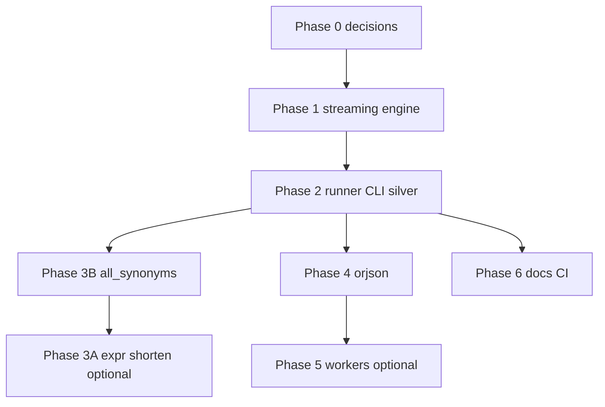

# Transform stage — performance, streaming silver, and production wiring

Implementation plan for evolving `pipeline/transform/` from the current prototype (`transform_records` + in-memory outcomes) into a production silver stage aligned with `pipeline/validate/` and `pipeline/paths.py`. Builds on [linkml-map-transformation.md](./linkml-map-transformation.md).

## Goals

1. **Stream silver output** to `universe/{run_id}/3-silver/{source_name}/fragments.jsonl` without holding ~775k fragments in RAM (ncbi-gene-info scale).
2. **Improve transform throughput** via engine hot-path fixes, optional JSON acceleration, and optional multiprocessing.
3. **Reduce per-row expression cost** for synonym merging (bronze normalization vs. transform `expr`).
4. **Mirror validate/ingest** layout: `context.py`, `runner.py`, `cli.py`, manifest + quarantine contracts.
5. **Keep single-pass bronze I/O** (one read, N `class_derivations` per row) — do not adopt LinkML-Map’s multi-scan `transform_spec` loop for this source.

## Non-goals (this plan)

- DuckDB / SQL compile backend for transform.
- Post-silver domain LinkML validation (defer unless explicitly added in Phase 0).
- Rewriting LinkML-Map itself.

---

## Current state

| Piece | Status |
| --- | --- |
| `pipeline/transform/engine.py` | `transform_records` → `(TransformSummary, list[TransformOutcome])`; calls `index()` every row; 4× `map_object` per row |
| Runner / CLI | Missing |
| Silver artifacts | Paths exist in `UniversePaths`; not written |
| `pipeline/run/runner.py` `_run_transform` | Stub / not wired |
| Ingest null normalization | Multivalued empty → `[]`, scalar empty → `null` (`NCBIGeneInfoAdapter._normalize_row`) |
| Synonym merge | Long `expr` on `GeneAliasRecord.synonyms` in `ncbi-gene-info.transform.yaml` |

---

## Phase 0 — Design decisions (block implementation)

Document in `pipeline/transform/README.md` (or extend universe contract in `pipeline/README.md`):

- [ ] **Fragment JSONL line schema** (recommended):

  ```json
  {
    "class": "Gene",
    "object": { "id": "silkg:Gene:1", "symbol": "A1BG", ... },
    "source": {
      "source_name": "ncbi-gene-info",
      "bronze_line": 0,
      "gene_id": "1"
    }
  }
  ```

  `source` keys: minimum `bronze_line` + one stable id from bronze row; optional `source` / `source_name` for downstream.

- [ ] **Quarantine line schema** — one line per failed mapping attempt:

  ```json
  {
    "bronze_line": 0,
    "target_class": "GeneAliasRecord",
    "bronze_record": { ... },
    "errors": ["TransformationError: ..."]
  }
  ```

- [ ] **Failure policy**: fail-fast (first error aborts run) vs. quarantine + exit code 1 if any quarantine (align with validate when bronze quarantine exists). Default recommendation: **quarantine per (bronze_line, target_class)**, continue, exit 1 if `rejected_count > 0`.

- [ ] **Partial row success**: one bronze row may yield 3 fragments and 1 quarantine line; do not roll back successful fragments for the same row.

- [ ] **`index()` policy**: for flat `NCBIGeneInfoRow` with no joins, **omit per-row `transformer.index()`** unless a test proves it changes output. LinkML-Map streaming path does not call `index()` per row.

- [ ] **Bronze run id**: `--bronze-run-id` defaults to `--run-id` (same pattern as validate’s `staging_run_id`).

---

## Phase 1 — Streaming engine API (memory fix)

**Files:** `pipeline/transform/engine.py`, optional `pipeline/transform/io.py`

### 1.1 Split responsibilities

| Function | Role |
| --- | --- |
| `build_object_transformer(...)` | Unchanged; load once per worker |
| `iter_bronze_records(path) -> Iterator[tuple[int, dict]]` | Rename/clarify `iter_records`; single place for JSON decode |
| `transform_bronze_row(transformer, record, line_number, source_row_class, class_derivations) -> Iterator[TransformOutcome]` | One bronze dict → yield 0..N outcomes (no list) |
| `transform_stream(records_path, ..., source_row_class) -> Iterator[TransformOutcome]` | File loop + row helper |
| `transform_records(...)` | **Deprecated wrapper**: `list(transform_stream(...))` for tests only, or remove after runner lands |

### 1.2 Engine hot-path (same PR or immediate follow-up)

- [ ] Precompute `list[tuple[str, ClassDerivation]]` once after load — stop calling `_find_class_derivation_by_name` inside the inner loop.
- [ ] Remove `transformer.index(record, ...)` per row unless Phase 0 tests require it.
- [ ] Keep **one file pass**, inner loop over derivations (preserve advantage over LinkML-Map multi-scan).

### 1.3 Tests

- [ ] `pipeline/transform/tests/fixtures/` — 2–3 bronze JSON lines (frozen).
- [ ] Assert `transform_stream` yields expected `class` + `object` for `Gene`, `GeneAliasRecord`, etc.
- [ ] Assert memory-safe usage: stream into a counter without materializing full list (optional `tracemalloc` smoke on fixture only).

### Acceptance

- [ ] Full ncbi bronze file can be processed with **bounded RAM** when consumer only writes JSONL (no giant `outcomes` list).

---

## Phase 2 — Runner, CLI, silver artifacts

**Files:** mirror `pipeline/validate/`:

```
pipeline/transform/
  context.py      # TransformContext
  runner.py       # run(...)
  cli.py
  __main__.py
  README.md
```

### 2.1 `TransformContext`

Fields (mirror validate):

- `run_id`, `bronze_run_id`, `source`, `source_name`, `source_row_class` (e.g. `NCBIGeneInfoRow`)
- `paths: UniversePaths = DEFAULT_PATHS`
- Optional: `workers: int = 1` (Phase 4)

### 2.2 `runner.run(ctx) -> int`

1. `mkdir` `paths.silver_run_dir(source_name, run_id)`.
2. Open `paths.bronze_records(source_name, bronze_run_id)` for read.
3. Open `paths.silver_fragments(...)`, `paths.silver_quarantine(...)` for write.
4. Iterate `transform_stream(...)`; for each outcome:
   - accepted → write fragment line (Phase 0 schema).
   - rejected → write quarantine line.
5. Update `TransformSummary` counters only in runner (or return summary from stream via mutable ref / yield summary at end).
6. Write `paths.silver_manifest(...)`:

   - `stage`: `transform`, `tier`: `silver`
   - `bronze_run_id`, schema paths, transform path, timestamps
   - counts: `input_record_count`, `fragments_written`, `quarantined`, `error_counts`
   - optional content hashes of spec + source schema (reproducibility)

7. Write `paths.silver_map(...)` — minimal snapshot: transform path, linkml-map version, derivation class names.

8. Return `0` if `rejected_count == 0` else `1` (if quarantine policy says so).

### 2.3 CLI

Flags aligned with `pipeline/validate/cli.py`:

- `--source`, `--source-name`, `--run-id`, `--bronze-run-id`, `--source-row-class`, `-v`

Entry: `PYTHONPATH=. python -m pipeline.transform.cli ...`

### 2.4 Orchestration

- [ ] Implement `_run_transform` in `pipeline/run/runner.py` calling `pipeline.transform.runner.run`.
- [ ] Uncomment `transform` in `pipeline/run/examples/ncbi-gene-info.yaml` when validate is wired.

### Acceptance

- [ ] E2E: bronze `universe/test/2-bronze/ncbi-gene-info/records.jsonl` → silver dir with `fragments.jsonl`, `manifest.json`, line counts matching ~4× accepted fragments per bronze row (minus quarantine).

---

## Phase 3 — Synonym merge and transform spec cleanup

Two tracks; pick **B** for best performance, **A** as interim.

### Track A — Shorten transform `expr` only

**Precondition:** ingest already sets multivalued empties to `[]` (true today).

- [ ] Simplify list slots: `synonyms` and `other_designations` without `if … else []`.
- [ ] Keep scalar wraps for `symbol`, nomenclature strings.
- [ ] Add fixture rows with `null` scalars and empty lists; assert unchanged silver output vs. baseline.

### Track B — Bronze field `all_synonyms` (recommended)

1. [ ] Add `all_synonyms` to `ncbi-gene-info.schema.yaml` (`multivalued: true`, description: derived, not a publisher column).
2. [ ] In `NCBIGeneInfoAdapter._normalize_row` (or shared helper), merge:
   - symbol (0–1), synonyms, symbol_from_nomenclature_authority, full_name_from_nomenclature_authority, other_designations
   - Policy doc: order, dedupe (optional), empty → `[]`.
3. [ ] Re-ingest / re-validate bronze for test run id.
4. [ ] Transform:

   ```yaml
   synonyms:
     populated_from: all_synonyms
   ```

5. [ ] Optionally switch other Gene slots to `populated_from` where trivial (`type_of_gene`, etc.).

### Acceptance

- [ ] `GeneAliasRecord` fragments match baseline on fixture set (or documented intentional dedupe change).
- [ ] Profile on 10k rows: measurable drop in `eval_expr` / `_derive_slot` time for alias records.

---

## Phase 4 — Faster JSON (`orjson`)

- [ ] Add `orjson` to project dependencies (document in README / deps file used by repo).
- [ ] Centralize in `pipeline/transform/io.py`:

  - `loads_line(bytes | str) -> dict`
  - `dumps_line(obj) -> bytes` (+ newline)

- [ ] Use in `iter_bronze_records` and runner writes.
- [ ] Fallback to stdlib `json` if `orjson` unavailable (optional; prefer hard dep for CI).

### Acceptance

- [ ] Same fragment output on fixtures; benchmark note in PR (optional `%` on 10k lines).

---

## Phase 5 — Optional multiprocessing

**When:** After Phase 2 stable; enable via CLI `--workers N` (default 1).

### Design

- Parent splits work by **line ranges** `[start, end)` on bronze JSONL.
- Worker entrypoint: `(chunk_start, chunk_end, paths, schema paths, ...)` → writes `fragments.part{i}.jsonl` and `quarantine.part{i}.jsonl` under silver dir or temp.
- Each worker: `build_object_transformer()` once, `transform_stream` limited to line range (skip until `start`, stop at `end`).
- Parent: merge summaries; concatenate part files in order → final `fragments.jsonl` / `quarantine.jsonl`; delete parts.

### Constraints

- Do not share one `ObjectTransformer` across threads.
- Document diminishing returns when disk-bound.
- `manifest.json` records `"workers": N` and part file list if shards kept.

### Acceptance

- [ ] `--workers 2` on fixture file 2× size produces identical merged JSONL order policy as single worker (define order: bronze_line, then derivation order).

---

## Phase 6 — Observability and regression guardrails

- [ ] `python -m pipeline.transform.engine` or CLI: support `--limit N` for dev runs.
- [ ] Document `cProfile` / `py-spy` one-liner in `pipeline/transform/README.md`.
- [ ] CI job (when CI exists): transform fixtures only; `linkml-map validate-spec` on `ncbi-gene-info.transform.yaml`.
- [ ] Optional: benchmark gate — transform 1k lines under X seconds ( flaky; use soft check).

---

## Suggested implementation order



**Minimum viable production path:** Phase 0 → 1 → 2 (fixes RAM + delivers silver).

**Performance path:** add Phase 3B + 4; Phase 5 if single-machine throughput still insufficient.

---

## Risks and mitigations

| Risk | Mitigation |
| --- | --- |
| Removing `index()` changes behavior for nested/join specs | Gate on Phase 0 tests; re-enable per source flag if needed |
| `all_synonyms` changes dedupe semantics | Document; compare counts on sample; version in manifest |
| Multiprocess merge order | Stable sort by `(bronze_line, target_class)` on merge if needed |
| Validate runner still materializes outcomes | Out of scope; transform plan does not block on validate refactor |

---

## References

- Existing skeleton: [linkml-map-transformation.md](./linkml-map-transformation.md)
- Paths: `pipeline/paths.py` (`silver_fragments`, `silver_quarantine`, `silver_manifest`, `silver_map`)
- Patterns: `pipeline/validate/runner.py`, `pipeline/validate/context.py`
- Transform spec: `sources/ncbi/ncbi_gene_info/ncbi-gene-info.transform.yaml`
- Ingest normalization: `sources/ncbi/ncbi_gene_info/adapter.py`
